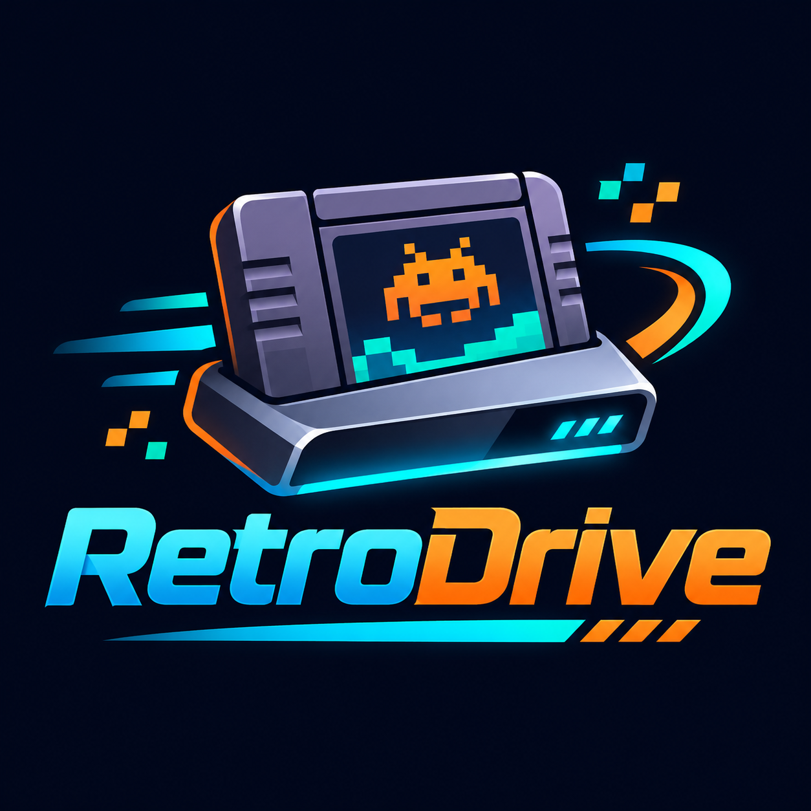

# RetroDrive — Source + Full Design Documentation

**Start with [`docs/00-START-HERE.md`](docs/00-START-HERE.md).** This package combines the prior v0.1 desktop scaffold with a comprehensive design handoff.

# RetroDrive

Early Windows desktop application for managing a full retro gaming setup.



## What works today
Full, maintained list: **[Features.md](Features.md)**.
- **Navigation:** Dashboard, Game Library, Drive Manager, Emulation Systems, Settings.
- **Drives:** read-only detection of mounted volumes. Drives are recognized by volume ID even when Windows gives them a different letter, and **Known drives** lists every scanned drive, plugged in or not.
- **Import:** scan an existing ROM folder in the background *without moving, modifying or deleting anything*. Shows live progress, can be cancelled, and the report lists ignored and unreadable files.
- **Activity:** every scan is logged. The Dashboard shows recent scans, including ones interrupted by a crash.
- **Catalog:** normalized SQLite catalog (schema v6) in the app data folder. Versioned migrations back up the catalog before upgrading it.
- **RetroBat (read-only):** add an existing RetroBat folder, see layout checks, and preview where each game would go (`roms\snes`, `roms\psx\<Game>\…`). Nothing is copied yet.
- **Disc games:** `.cue` + `.bin` sets and multi-disc `.m3u` games count as one game, with their total size; missing tracks are flagged **Incomplete**.
- **Library:** fast full-text search, 100-row pages, and filters by platform, status (**Online** / **Offline** / **Missing**) and drive. Sorts by title, platform or size. Possible duplicate copies are flagged (never deleted). Measured at 100,000 files: most pages take 1–3 ms.

## Not yet implemented
This is an **early development build**, not a drive installer. No imaging, formatting, partition creation, ROM deployment, metadata scraping, BIOS repair, controller mapping, or automatic updates are implemented. The platform labels are a roadmap, not functional installers.

## Requirements (Windows)
- Node.js LTS and npm
- Rust toolchain (rustup, stable MSVC target)
- Microsoft C++ Build Tools (Desktop development with C++)
- WebView2 runtime (typically included in Windows 11)
- Git and Visual Studio Code (recommended)

See Tauri's official Windows prerequisites: https://v2.tauri.app/start/prerequisites/

## Run locally
```powershell
npm install
npm run tauri dev
```

The first Rust build can download numerous dependencies. To compile a production installer later:
```powershell
npm run tauri build
```

`npm run dev` alone opens the UI in a browser, but native commands **do not** work without Tauri.

## Create your GitHub repo
The project lives at **https://github.com/gollum10/RetroDrive** (private). Clone it outside OneDrive:
```powershell
git clone https://github.com/gollum10/RetroDrive.git C:\dev\RetroDrive
```
Original first-push steps, kept for reference:
```powershell
git init
git add .
git commit -m "Initial RetroDrive scaffold"
git branch -M main
git remote add origin https://github.com/YOUR_USERNAME/retrodrive-studio.git
git push -u origin main
```
Replace `YOUR_USERNAME` with your GitHub account. GitHub may prompt for authentication.

## Legal
RetroDrive doesn't include or download games, BIOS or firmware; it organizes and copies files you choose, for your personal use. It isn't for preparing drives or machines for others or for sale. See [docs/16-LEGAL-AND-COMPLIANCE.md](docs/16-LEGAL-AND-COMPLIANCE.md) for the legal assessment and [docs/17-THIRD-PARTY-COMPONENTS.md](docs/17-THIRD-PARTY-COMPONENTS.md) for the component inventory.

> RetroDrive is an independent retro gaming management application. All third-party product names and trademarks belong to their respective owners. Compatibility references do not imply sponsorship, affiliation, or endorsement. *(Draft wording, pending counsel review.)*

## Design rules
- Always use a preview and explicit confirmation before potentially destructive disk operations.
- Start with a hybrid catalog: game identity, physical files, and deployment manifests will eventually be separate entities.
- Do not bundle copyrighted ROMs or BIOS firmware.
- Store user library data locally; future sync is opt-in.
- Platform adapters must follow upstream platform layout, terms, and licensing.

## Current simplifications
- **Game identity:** each game is one file or one disc set. Matching against metadata databases is planned; duplicates are flagged by name and size, not yet by hash.
- **Platform guesses** come from folder names and extensions; ambiguous archive and disc files are marked `Unclassified`.
- **Verified 2026-11-04** on Windows 11 with Node 24, Rust 1.99.1 and VS 2026 C++ tools: `cargo test` (168 passing; 350 as of 2026-11-10), `npm run build`, and `npm run tauri dev`, including 40,000-file scans, cancel, crash recovery, drive recognition, search, paging, duplicates, disc grouping and the RetroBat placement preview, plus (2026-11-05) the RDS-009 deployment plan and the RDS-010 verified copy (copy, stale-plan refusal and cancel tested in the app; see docs/18).

## License

RetroDrive is free and open source under the [Apache License 2.0](LICENSE) (see also
[NOTICE](NOTICE)). Copyright 2026 The RetroDrive contributors. The open-source components
it's built with keep their own licenses, listed in
[`THIRD_PARTY_NOTICES.txt`](src-tauri/resources/THIRD_PARTY_NOTICES.txt); data files are
credited in [`THIRD_PARTY_CONTROLLERS.txt`](src-tauri/resources/THIRD_PARTY_CONTROLLERS.txt).
Privacy: [docs/legal/PRIVACY.md](docs/legal/PRIVACY.md). Questions and problems:
[GitHub Issues](https://github.com/gollum10/RetroDrive/issues).
