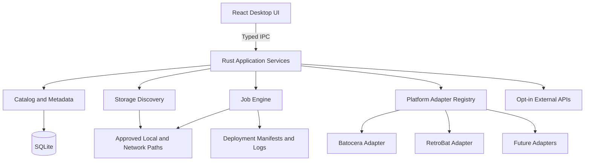

# 04 | Technical Architecture

**Native comparison preparation:** an opt-in test now generates original compiler-produced themes, inert game markers and a disposable home configuration without launching RetroBat. [Preparation and pending native checks](theme-studio/native-comparison.md). Native behavior and launch isolation remain unverified.


**Candidate package assembly:** a read-only catalog snapshot now resolves used managed PNGs, checks exact length/hash/signature and assembles bounded deterministic XML/assets/credits/manifest files in memory. Native verification, full licensing/privacy audit and user-facing export remain disabled. [Details](theme-studio/retrobat-export-plan.md#managed-asset-package-spike).


**Experimental RetroBat compiler:** a pure in-memory candidate compiler now produces bounded XML and used-PNG declarations for a strict subset. It does not enable export, resolve asset bytes or write target files. See [scope and evidence](theme-studio/retrobat-export-plan.md#compiler-spike-implementation).


**RetroBat export groundwork:** [pinned evidence and minimal exporter plan](theme-studio/retrobat-export-plan.md) now defines the pure compiler, exact installed-engine capture and native acceptance gates. This is planning only; no exporter or installation support is enabled.


**VIS-004 partial typography:** text layers now support left/center/right alignment within their existing rectangle, including sample-bound multiline captions. Unknown values stay preserved read-only; source edits use existing history and draft/checkpoint persistence. Wrapping, vertical alignment, custom fonts and native engine output remain unimplemented.


**Sample preview:** sample-data.ts provides an explicit six-source typed catalog and original synthetic value maps. SceneCanvas resolves recognized text/number slots to bounded literal text; NodeInspector uses TextBindingControls for source edits through normal graph/session services. No expression traversal/eval, IPC, catalog/library reads or image sources are resolved by this text-only increment.

**Image presentation:** pure image-presentation helpers validate/preserve style fit/crop data; ImageControls uses shared NumberField and existing graph/history/persistence callbacks. ImageLayer resolves intrinsic dimensions only from authorized PNG data, renders a cropped SVG viewBox and an explicit source-region clipPath so Fit margins cannot reveal outside pixels. No native API, storage or permission changes.

**Preview reopen correction:** useImagePreviews shares promises keyed by project ID, asset ID, hash and byte count across effect restarts, keeps cancelled effects from publishing, and renders immutable loaded state rather than mutable ref cache contents. Busy worker responses retry at most four attempts; other errors require user retry. Native authorization/integrity checks are unchanged.

**PNG workflow:** two background commands accept bounded base64 bytes/project ID or saved project ID/asset ID, never filesystem paths. image_store normalizes into immutable SHA-keyed SQLite blobs and re-verifies reads. The UI attaches portable asset declarations/image nodes through existing ProjectSession, then loads a bounded PNG-only data-URL cache. Source file selection uses a browser File grant; existing CSP already permits PNG data images.

**PNG boundary:** theme_studio::image_import is pure bytes-in/normalized-PNG-out code using checked chunk framing/CRC, bounded decoding and a fresh RGBA8 encoder. It returns a normalized-byte hash and portable declaration path. No IPC, filesystem, target writer or UI integration is added; managed storage/preview authorization follows separately.

**Layer state:** scene-edit.ts recognizes additive node.editor.locked/hidden booleans and preserves other editor fields. LayerList changes flags separately from guarded content edits. Shared eligibility blocks protected updates, canvas hides hidden nodes, and a flag change cancels active gestures. No database/backend migration.

**Canvas aids:** snapping.ts supplies pure rotated bounds, grid rounding and canvas alignment functions. SceneCanvas owns session-only aid state, renders a pointer-transparent SVG pattern/guides, and applies snapping only to pointer previews/releases. Existing unit conversion/history/persistence boundaries remain unchanged.

**Canvas focus/layout correction:** resize pointer-down prevents default focus transfer and focuses its handle; canvas blur cancels only when focus leaves the SVG subtree. Container queries now size the editor from available workspace width, accounting for the application sidebar. No source/persistence/backend changes.

**Resize gestures:** SceneCanvas extends its local pointer preview to width/height; resize.ts projects canvas deltas into rotated local axes and applies immutable, unit-preserving bounded dimensions. Only pointer release commits through ProjectSession. Numeric inspector sizing remains available. No backend/schema/dependency changes.

**Canvas alignment:** alignment.ts computes rotated local rectangle bounds using the same top-left pivot as SceneCanvas, then updates only the chosen position dimension through existing graph/history/persistence services. AlignmentControls guards unsupported/no-op/busy actions. No schema, backend or dependency changes.

**Transform controls:** NodeInspector uses guarded transformNode updates for finite rotation and numeric opacity, preserving layout/style extensions. Existing updateNode eligibility, session history and serialized persistence are reused; SVG already renders these fields. No backend/schema/dependency change.

**Layer ordering:** immutable orderLayer operations rearrange existing node references in the scene array; SVG and layer navigation consume that same back-to-front order. LayerOrderControls blocks unsupported/nested scenes and busy/copy states. History/persistence are reused, without new schema or backend behavior.

**Canvas authoring:** scene-edit.ts provides immutable unit-aware graph operations; SceneCanvas renders an allowlisted SVG subset with local pointer previews; NodeInspector edits recognized properties only. ProjectSession owns bounded EditHistory and sends undo/redo through the same serialized persistence queue. No compiler, schema migration, media execution or new dependency. [Details](theme-studio/canvas.md).

**Theme Studio close protection fix:** async close handler waits for persistence and cancels only unsuccessful/duplicate requests. The installed Tauri SDK then invokes window.destroy; main capability explicitly permits it. No recursive window.close invocation or new filesystem/installation authority. Logic is isolated in theme-studio/window-close.ts and tested against the real SDK wrapper using stubbed IPC.

**Theme Studio PR 4:** separate pure ThemeAdapter capability contract and empty production registry; TargetProfile distinguishes detected app release from an exact engine/fork/platform/format tuple. Read-only background discovery/report IPC accepts saved installation IDs or project intent only. [Matrix](theme-studio/target-matrix.md). No game adapter or deployment behavior changes.

**Theme Studio PR 3:** React workspace components use a renderer-independent ProjectSession write queue; App invokes its leave guard. A read-only background validate_theme_document command validates raw stored source before editing. Native close waits for persistence, browser unload prompts. No changes to Customize or target writers. [Details](theme-studio/workspace.md).

**Theme Studio PR 2:** `theme_studio::{projects, commands}` provides transactional SQLite storage with optimistic revision checks and structured errors. Eight background commands operate only on the managed catalog; frontend wrappers are `src/theme-studio/api.ts`. Source/checkpoint/draft are independent of target files. See [persistence](theme-studio/persistence.md). Existing Customize and deployment services are unchanged.

**Theme Studio PR 1 (2026-11-08):** `theme_studio::{model, validation}` is a pure Rust universal-document boundary with matching `src/theme-studio/types.ts`. Option B keeps source independent of target compilation. SQLite working-state persistence is PR 2; future React editor separates scenes/layers, canvas, inspector and timeline. No new IPC/storage/target writes or changes to Customize/game adapters. See [contract](theme-studio/project-format.md).

## Baseline stack
- **Windows desktop:** Tauri v2, React, TypeScript, Vite.
- **Native services:** Rust, Tauri commands/events; no arbitrary shell execution from frontend.
- **Database:** SQLite in app-data folder; migrations and transactional writes.
- **UI state:** React with query/pagination patterns for large libraries.
- **External sources:** official upstream release/download APIs as supported; user-authorized metadata provider APIs.
- **Optional future:** NAS via mapped drive/SMB and authenticated remote agents, not required for local operation.

## Logical view


## Modules/interfaces
- `storage`: read-only physical/volume discovery, stable IDs, mount status, access permissions and protected-disk tagging.
- `catalog`: indexed roots, file metadata, game identity, deduplication and matching confidence.
- `platforms`: `PlatformAdapter` with `detect`, `capabilities`, `validateLayout`, `planFilePlacement`, `renderMetadata` and, later, `install`/`upgrade` gates.
- `deployment`: immutable plan, target validation, staging, verify, commit, resumable job journal.
- `metadata`: provider client, rate-limit/caching, provenance and manual editing.
- `maintenance`: check registry, diagnostics, repair plans, backup-first operations.
- `jobs`: state machine and cancellations; events for UI progress; durable log.
- `settings`: provider keys stored through platform secure storage as feasible; user-approved roots and options.

## Platform adapter contract (implemented, now contract v3, in `src-tauri/src/adapters/mod.rs`; the TypeScript below is the original concept)
```typescript
interface PlatformAdapter {
  id: string;
  displayName: string;
  kind: 'bootable-os' | 'portable-app' | 'frontend';
  detectInstallation(root: string): Promise<DetectionResult>;
  validateLayout(root: string): Promise<ValidationResult>;
  planGameFiles(request: DeploymentRequest): Promise<PlannedFile[]>;
  capabilities(): AdapterCapabilities;
}
```
Installation and updates intentionally require independent, more privileged interfaces and separate threat reviews. Adapter IDs/versioning must remain stable across schema migrations.

## Job lifecycle
`queued -> preflight -> awaiting_confirmation -> running -> verifying -> committing -> completed` with branches to `paused`, `cancelling`, `cancelled`, `failed`, `recovery_required`. Persist state at safe boundaries so a restart can identify unfinished jobs. Write temporary files in target filesystem when possible; atomic rename on completion when supported; no manifest success before verification.

## Trust boundaries
Frontend is unprivileged. Rust services validate all command arguments. The `rdmedia` protocol serves only images already linked to a game in the catalog (never a path supplied by the page). The only file writes are the copier's (docs/18): user-confirmed, scoped to one installation, never overwriting or deleting, never through links, and re-checked against the reviewed plan's fingerprint and the drive's identity. A future high-privilege disk helper, if needed, must use a narrow allowlist, per-operation user approval, a verified physical disk identity and no generic command interpreter.

## Performance and reliability
- Paginate game lists; index title/platform/status.
- Use incremental enumeration and background hash queues, not hash every multi-terabyte collection during first import.
- Store relative paths where possible with stable root identifiers.
- Handle Windows long paths, case-insensitive comparisons, network interruptions and filesystem permissions.
- Never update catalog to reflect a write until verified.

## Implemented today (updated 2026-11-05, M1 plus RDS-006/007/009/010)
Native backend modules in `src-tauri/src/`:

| Module | Responsibility | Target module above |
|---|---|---|
| `lib.rs` | Tauri setup and commands: `query_games`, `library_stats`, `system_summary`, `import_reference`, `reference_status`, `remove_reference`, `set_game_art`, `remove_game_art`, `set_left_out`, `list_backups`, `undo_replace`, `open_backup_folder`, `emulator_settings`, `preview_emulator_settings`, `list_designs`, `create_design`, `save_design_draft`, `finish_design`, `abandon_design`, `delete_design`, `music_settings`, `preview_design`, `apply_design`, `design_applications`, `undo_design_application`, `look_options`, `preview_look`, `apply_look`, `add_retrobat_media`, `list_themes`, `theme_preview_asset`, `create_theme_remix`, `preview_theme_switch`, `apply_theme_switch`, `apply_emulator_settings`, `emulator_settings_history`, `undo_emulator_settings`, `duplicate_cleanup_preview`, `clean_up_duplicates`, `list_collections`, `create_collection`, `rename_collection`, `delete_collection`, `add_to_collection`, `remove_from_collection`, plus the `rdmedia` image protocol, `list_adapters`, `inspect_installation`, `add_installation`, `list_installations`, `remove_installation`, `set_arcade_system`, `deployment_plan`, `start_deployment`, `list_storage_locations`, `start_scan`, `cancel_job`, `active_scan`, `recent_jobs`, `list_drives`. At startup it migrates the catalog and recovers interrupted jobs; if that fails, every command returns the error. Holds the in-memory registry of running jobs and their cancel flags. | app services |
| `jobs.rs` | Durable job log: create, add events, finish, list recent, recover interrupted. | `jobs` |
| `adapters/mod.rs` | `PlatformAdapter` trait (contract v3, read-only; v2 adds `PlacementOptions` such as the arcade choice to each request; v3 adds `Capabilities::copy_games`, which the copier requires, and `Detection::hint` for near misses), shared helpers `has_entry` and `plan_in_roms`, `registry()`, `detect_all()`, `catalog()` and `folder_name()` for Windows-safe names. | `platforms` |
| `adapters/retrobat.rs` | RetroBat detection, layout checks and placement rules, with facts cited from the RetroBat wiki in the module docs. Its system-folder map is shared with Batocera. | `platforms` |
| `adapters/batocera.rs` | Batocera (RDS-008): detection of the game folder (`\\BATOCERA\share` or `<drive>\batocera`), hints for the boot partition, layout checks and placement previews. `copy_games: false`. | `platforms` |
| `installations.rs` | Inspect a folder, save, list and forget installations. | `platforms` |
| `deployment.rs` | RDS-009 deployment plan (read-only): places every available game with the adapter, classifies each destination file (copy, already there, already in place, duplicate, conflict, blocked), measures capacity and returns a plan fingerprint. Only reads metadata; never creates or writes. | `deployment` |
| `collections.rs` | The user's collections: list, create, rename, delete, add and remove games (catalog lists only). | `collections`, `collection_games` |
| `designs.rs` | Designs: named RetroBat customizations (theme choice/remix, retrobat.ini options, own video, music settings and tracks, per-system settings) kept in the catalog as finished spec + draft; seed from an installation; preview and apply as one step (files first, then es_settings.cfg and retrobat.ini through `customizer::write_file`, rolling back the first if the second fails); undo an application. | `designs`, `design_applications` |
| `gamelists.rs` | Game art and details in RetroBat's `roms/<system>/gamelist.xml` for games RetroDrive copied (`preview`, `apply`): picks the user's art (own pick > box art > image; thumbnail and marquee separately) and reference-catalog details, adds only missing tags/entries as minimal text edits, copies images as new files (temp, SHA-256 read-back, no-replace), writes lists through `customizer::write_file`, records a `design_applications` row for undo. File checks and image copies run 16 at a time (`parallel_map`; on a network share each check mostly waits on the network: 4,034 games went from 10 minutes to 24 seconds on the owner's NAS, 2026-11-07); an image already at the target name is compared by size before contents. Commands `preview_retrobat_art`, `apply_retrobat_art` (both emit `art-progress` `{phase: checking|copying, done, total}`); `start_deployment` takes `add_art` and runs it after the copy (`deploy-finished.art`). |
| Sync (2026-11-07, ADR-043) | `deployment::plan_sync` (the sync scope; ADR-045), `mark_removed` (games copied before and now gone: `removed` / `kept_off`), `installations::{sync_skip, set_sync_skip, kept_off, set_kept_off}`; commands `sync_plan`, `set_sync_skip`, `set_kept_off`; the copy itself is the normal `start_deployment` with `add_art`. `copier::still_confirmed` skips re-reading an already-there file confirmed earlier and unchanged since. |
| Choices (2026-11-07, ADR-044) | `src/Decisions.tsx` (`DecisionsLine`, `DecisionsPanel`: groups plan lists by choice situation, per-row and "for all" choices); `installations::{saved_choices, set_saved_choices}` and commands `saved_choices`, `set_saved_choices` (`installations.choices_json`; *replace* never saved). `App.tsx` loads saved choices when a plan or Sync opens and saves on every change; the copier receives the same map as before. |
| Sync scope (2026-11-07, ADR-045) | `deployment::{sync_scope, add_to_sync_scope}` (saved scope, or derived from copied games still on the drive), `build(..., scope, ...)` filters to scope systems ∪ scope collections' games; `mark_removed` relabels conflicts on previously copied files as `changed`. `installations::{SyncScope, saved_sync_scope, set_sync_scope}`; commands `sync_scope`, `set_sync_scope`; `start_deployment(sync)` → `DeployRequest.sync` (the copier rebuilds the sync plan); `run_deployment` adds a plan copy's systems or collection to the scope after it finishes (completed, with issues, or cancelled with something copied). `sync_skip` removed. |
| Batocera art and Sync (2026-11-07, ADR-047) | `gamelists::GAMELIST_PLATFORMS` (`retrobat`, `batocera`); `customizer::install_for` (game lists accept both; `install` stays RetroBat-only for settings); `customizer::never_running` and `lib.rs` `running_for` (Batocera never blocks on a local process) and `batocera_note` (Update Gamelists tip); `undo_design_application` uses the installation's running check. UI: `GAMELIST_PLATFORMS` in `App.tsx` (Sync button, add art on copy), `Customize.tsx` (Batocera: art and applied designs only). |
| Batocera settings (2026-11-07, ADR-048) | `batocera_settings.rs`: `settings` (offered keys and values), `conf_values`/`conf_edit` (line edits like Batocera's `SystemConf::saveSystemConf`, verified to change only the wanted keys), `options`, `preview`/`apply`, `preview_theme`/`apply_theme`; writes through `customizer::write_file` (journal, backup, undo, recovery). Commands `batocera_options`, `preview_batocera_settings`, `apply_batocera_settings`, `preview_batocera_theme`, `apply_batocera_theme`; `undo_emulator_settings` now uses the installation's running check. UI: `src/BatoceraSettings.tsx`. |
| Install helper (2026-11-07, ADR-049) | `install_helper.rs`: `inspect` (magic bytes: gzip, xz with footer check, zip, raw disk image by MBR signature; size; name → system, version, hardware), `checksum` (SHA-256 or MD5 by length; progress), `writers`/`open_writer` (Raspberry Pi Imager or balenaEtcher found only in their install folders; image passed as one argument), `open_download_page` (fixed official URLs). Commands `install_image_info`, `install_checksum` (event `install-hash`), `install_writers`, `open_install_writer`, `open_download_page`. UI: `src/InstallHelper.tsx`. New dependency `md-5`. |
| Install helper, every system (2026-11-09, ADR-103) | `install_helper::download_page` adds `recalbox`, `rocknix`, `rocknix-devices`, `lakka`, `retrobat`, `esde` (fixed official addresses); `name_facts` recognises Recalbox, ROCKNIX and Lakka image names (`recalbox_board`, `lakka_board`). `InstallHelper.tsx`: `SYSTEMS` entries are `kind: 'image'` (card flow; `checksum` may be null, optional `tip`, `devices`) or `kind: 'app'` (download → install it → Find it, `onFind` opens the setup wizard task `system`). Adapter cards: every system shows Helps you install it. |
| App looks (2026-11-09, ADR-104) | `src/style.css`: colours are `var(--c-<hex>)` tokens defined in one `:root` block (between `/* app-looks:tokens */` and `/* app-looks:end */`). `src/looks.css`: generated palettes per look (`:root[data-look="galactic"|"bridge"]`) plus hand-written effects. `scripts/app-looks.py` tokenizes and regenerates (`--check` in CI). `src/looks.ts`: `LOOKS`, `savedLook`, `applyLook` (localStorage `rd.look`); `main.tsx` applies it before render and imports the latin font subsets; App's Dashboard header has the Look switch. |
| Theme Studio follows the looks (2026-11-10, ADR-107) | `scripts/app-looks.py` `EXTRA` lists other stylesheets that use the shared `--c-<hex>` tokens without a token block of their own (now `src/theme-studio/theme-studio.css`); their colours are added to style.css's token block and the palettes, and `--check` fails on raw colours in them. |
| Theme Studio tool levels (2026-11-10, ADR-108) | `src/theme-studio/skill.ts`: `LEVELS`, `shows(level, tool)` (tools: panel, order, numbers, layerName, details from Standard; units, transform, crop, check, timeline from Pro), `savedLevel`/`saveLevel`. `ProjectOverview` renders the Tools switch and gates its tools; `NodeInspector` takes `tools` and `ImageControls` takes `showCrop` (both default to everything). `document.ts` `readyLayout(role)` builds the Ready layout (template `ready`, the wizard default). |
| Theme Studio layout (2026-11-10, ADR-109) | `ProjectOverview`: screen tabs (`nav.ts-screens`) above `.ts-editor-grid`, whose areas are `layers canvas side` (wide), `canvas layers / canvas side` (container ≤1150 px) and stacked (≤760 px); `.ts-layers` and `.ts-inspector` are sticky with their own scrolling. `AlignmentControls` and `LayerOrderControls` return nothing without a selected layer. |
| Theme Studio pictures (2026-11-10, ADR-110) | `ImageImportForm.encodePictureFile`: PNG within limits passes through `encodePngFile`; otherwise `createImageBitmap` → canvas → `toBlob('image/png')`, scaled to ≤4096 px a side, ≤4,194,304 pixels and ≤16 MB (up to five tries at 75 %). `image-assets.attachImage(..., { placement: 'free' | 'background' | 'over', overId, aiMade })` and `creditFor`. `scene-edit.deleteNode` (editable layers only). `ProjectOverview`: Delete layer button and Delete key. |
| Theme Studio game video (2026-11-10, ADR-111) | `scene-edit`: `GAME_VIDEO` (`{ source: 'game.video', kind: 'video' }`), `addNode(..., 'video')`; `supportedNode`, `canOrderLayers` and the canvas include `video`. `SceneCanvas` draws a placeholder. `ImageImportForm` takes `initialPlacement`; `ProjectOverview` has Add game video and Add a frame over it. `theme_studio/validation.rs`: binding `game.video` → kind `video`; `video` in the known layer types. |
| Theme Studio game list and RetroBat mappings (2026-11-10, ADR-112) | `scene-edit`: `GAME_LIST_STYLE`, `NewLayer`, `addNode(..., 'game_list')`; `SceneCanvas.GameListPreview`; `NodeInspector` game-list colours. `export/retrobat.rs`: native kinds `textlist` (gamelist), `video` (md_video, centred, `maxSize`), `datetime` (md_releasedate); bindings `system.name`→`logoText`, `game.players`→`md_players`, `game.year`→`md_releasedate`; `HIDDEN_DEFAULTS` emitted as `visible false` on the detailed view when not placed. `validation.rs`: `game_list` is a known layer type. |
| Theme Studio Save for RetroBat (2026-11-10, ADR-113) | Frontend `export-retrobat.ts`: `planExport` (screens, bake/live groups, notes), `loadPictures` (sequential previews, busy retry), `drawLayers` (canvas drawing matching the editor), `bakeScreens`, `exportDocument`; `SaveForRetroBat.tsx`. Backend `theme_studio/export/save.rs`: `prepare_baked` (normalize, no storage), `build` (revision check, compile, baked vs stored pictures, credits, manifest, safe file names, 32 MB budget, read-only transaction), `write_new_folder` (`free_folder`, "(incomplete)", create_new, read-back, `rename_no_replace`). Commands `prepare_theme_bake`, `theme_save_destination`, `save_theme_for_retrobat`, `open_saved_theme`; `image_gate()` waits and recovers. |
| Theme Studio Put on RetroBat (2026-11-10, ADR-115) | `export/save.rs::put_on_retrobat(themes_dir, saved)` (manifest-listed files only, size and SHA-256 rechecked, `write_new_folder`); command `put_theme_on_retrobat` (`customizer::install`, `claim_drive_change`). `SaveForRetroBat.tsx`: installation picker, then `preview_theme_switch` + `apply_theme_switch`. `export/retrobat.rs`: the detailed view is written as `detailed, video`. |
| More looks (2026-11-10, ADR-105) | `scripts/app-looks.py` rules `cartoon` (lightness flipped: a light look) and `versus`; `galactic` rule now steel and red. `src/looks.css` effects for both; Cartoon overrides the named `white` uses in style.css (main button text, search input) and keeps game-cover text light. `LOOKS` has five entries; `main.tsx` imports the Fredoka (600, 700) and Russo One (400) latin subsets. |
| RetroPie adapter (2026-11-07, ADR-050) | `adapters/retropie.rs` (detect, validate, plan with `retropie_folder` over `retrobat::system_folder`), `adapters::plan_in(prefix, …)` (`plan_in_roms` = `plan_in("roms/", …)`), `PlacementOptions.has_roms_folder` (set in `installations::located`), `DeploymentPlan.systems_prefix`. |
| RetroPie Sync and art (2026-11-07, ADR-052) | `gamelists::GAMELIST_PLATFORMS` includes `retropie`; `games_dir` (system folders at `roms\` or the root); `plan(…, create_lists, …)` skips RetroPie systems without a rom-folder list unless asked (`ArtPreview.lists_not_created`); commands `preview_retrobat_art`/`apply_retrobat_art` take `create_lists`; `run_deployment` never creates lists; `running_for`/`batocera_note` cover RetroPie. UI: `GAMELIST_PLATFORMS` in `App.tsx`, opt-in box in `Customize.tsx`. |
| RetroPie settings (2026-11-07, ADR-053) | `retropie_settings.rs`: `configs_root` (`\\host\roms` → `\\host\configs`), `parse`/`set_default` (only the `default` line; checked), `options`, `preview`, `apply` (per-file SHA check; `customizer::write_file` with the configs share as root, no stable id; rollback if one fails). Commands `retropie_options`, `preview_retropie_emulators`, `apply_retropie_emulators`. UI: `src/RetroPieSettings.tsx`. Undo messages no longer name RetroBat. |
| ES-DE adapter (2026-11-07, ADR-054) | `adapters/esde.rs` (detect with `has_esde_markers`, `rom_directory_setting`; validate; plan with `esde_folder` over `retrobat::system_folder`, `plan_in("")`); RetroPie's detect returns NotDetected on ES-DE markers; `DeploymentPlan.systems_prefix` empty for ES-DE. |
| BIOS files (2026-11-07, ADR-056) | `classify::classify` (anything under a `bios` folder is BIOS, `BIOS_SKIP`), `PlacementRequest.bios_path` (set in `deployment::gather` from the path below the first `bios` segment), `adapters::plan_bios(folder, …)` (keeps subfolders; refuses `..`, housekeeping files and `[BIOS]` archives); used by RetroBat/Batocera (`bios`), RetroPie with `has_roms_folder` (`BIOS`); RetroPie share and ES-DE return reasons. |
| ES-DE art (2026-11-07, ADR-057) | `gamelists::Layout` (`InFolder` / `EsDe { data, media }`), `esde_data_dir`, `esde_media_dir`, `esde_has_media`; `plan_system` writes ES-DE lists without image tags and plans `covers`/`marquees` copies; `apply` journals ES-DE lists with the data folder as root and skips unchanged lists. `customizer::esde_running` / `any_running` (process walk shared with `retrobat_running`); `lib.rs` `running_for` uses it for ES-DE. |
| Recalbox adapter (2026-11-07, ADR-058) | `adapters/recalbox.rs` (`has_recalbox_conf`, detect, validate, plan with `recalbox_folder` over `retrobat::system_folder`, `plan_in_roms`, `plan_bios("bios")`); Batocera, RetroPie and ES-DE return NotDetected on `recalbox.conf`. |
| BIOS step (2026-11-07, ADR-061) | `bios_step.rs`: `bios_share`, `esde_retroarch`, `retroarch_system_dir`, `target_for`, `library_bios` (catalog BIOS files below `bios`, connected, no housekeeping), `plan_into`, `preview`, `apply` (uses `gamelists::parallel_map` + `copy_image`). `adapters::is_housekeeping` shared with `plan_bios`. Commands `preview_bios_step`, `apply_bios_step` (progress on `art-progress`). UI: `src/BiosStep.tsx`. |
| Controllers (2026-11-07, ADR-062) | `controllers.rs`: owner's list compiled in (`resources/controllers.tsv`, `controller_types.tsv`, `controller_sources.tsv`, `THIRD_PARTY_CONTROLLERS.txt` via `include_str!`); `lookup(vid,pid)`, `search(query)`, `reference()`, `connected()` (Raw Input `GetRawInputDeviceList`/`GetRawInputDeviceInfoW`, HID usage page 1 usages 4/5/8, `HidD_GetProductString`, deduped per device). Per-row info, never merged across rows that share a USB ID; a type is trusted only when its keyword is in at least half of the row's names (`mixed_names` otherwise). Commands `connected_controllers`, `find_controllers`, `controller_reference`. UI: `src/Controllers.tsx`. |
| Controller confirm (2026-11-07, ADR-063) | `controllers::{describe, suggest, guess_from_name, remembered, remember}`: suggestion order remembered → list type (when certain) → whole words in the product/list name → XInput (device path contains `IG_`) = offset sticks (CT07). `Connected { xinput, suggested, suggested_by }`. Table `controller_choices` (schema v21). Command `remember_controller_type(vid, pid, type_id|null)`. UI: `src/Controllers.tsx` (`ConfirmCard`), drawings `src/ControllerOutline.tsx`. |
| Controller setup (2026-11-07, ADR-064) | `controller_setup.rs`: bundled `sdl_windows.txt` (GUID → USB ID via `guid_usb`) and `retroarch_joypads.txt` (`@@ driver/file` chunks; `ra_fields` reads `input_vendor_id`/`input_product_id`/`input_device`). `plan_retrobat` (XInput or known in `emulationstation\gamecontrollerdb.txt`, the user `.emulationstation\gamecontrollerdb.txt` or `es_input.cfg` → ready; else append SDL lines to the user file), `plan_retropie` (`\\host\configs\all\retroarch-joypads`: new udev files unless one has the USB ID or device name), `plan_retroarch` for ES-DE (`joypad_autoconfig_dir`, `input_joypad_driver`: xinput→dinput files, sdl2), Batocera/Recalbox → menu steps. `preview`, `apply` (each file through `customizer::write_file`; failures undo earlier files). Commands `controller_setup_preview`, `apply_controller_setup`. UI: `SetupPanel` in `src/Controllers.tsx`. |
| Controller tick box (2026-11-07, ADR-065) | `controllers::{confirmed, display_name}`; `controller_choices.xinput` (schema v22, saved with the confirmation). `controller_setup::{for_installation, apply_for_installation}`. Command `controllers_for_installation`; `start_deployment(…, setup_controllers)` → `run_deployment` sets controllers up after a copy that didn't fail; `deploy-finished` carries `controllers`. UI: confirm list in `src/App.tsx`. |
| Light guns (2026-11-07, ADR-066) | `lightguns.rs`: `guns()` (14 guns: tracking, distance, setup/RetroBat/Batocera steps), `identify` (product-name words from Batocera's udev rules; GunCon USB IDs), `connected` (via `controllers::pointing_devices`: HID usage page 1 usage 2, plus vendor 0b9a; `controllers::hid_scan` shared with controller detection), `remembered`/`remember` (`gun_choices`, schema v23), `is_gun_game` (EmulationStation's rule), `game_ids` (cached by library size). `adapters::batocera_folder`. `catalog`: `GameQuery.lightgun_only`, `GameRow.lightgun`. Commands `light_guns`, `remember_light_gun`. Data `resources/gun_games.tsv` (791, from Batocera EmulationStation `gamesdb.xml`, MIT). UI: `src/LightGuns.tsx`, Game Library filter and badge in `src/App.tsx`. |
| Sinden software (2026-11-07, ADR-067) | `sinden_step.rs`: `status` (each RetroBat: `system\tools\sinden\Lightgun.exe` there?), `preview`/`apply` (`plan`: the source must contain `Lightgun.exe`, isn't inside the target or the reverse, at most 3,000 files / 2 GB, links skipped; new files only via `gamelists::copy_image` + `parallel_map`; different files kept). Commands `sinden_status`, `preview_sinden_step`, `apply_sinden_step` (progress on `art-progress`). UI: `SindenStep` in `src/LightGuns.tsx`. |
| Recalbox settings (2026-11-07, ADR-068) | `recalbox_settings.rs`: `settings()` (Recalbox's keys, values and defaults), `options`, `preview`, `apply` (checked against the reviewed file hash; `customizer::write_file`), theme as `emulationstation.theme.folder` in the same file. Edits through `batocera_settings::edit_conf` (shared; `;` is Recalbox's disabled mark), `conf_values`, `systems`, `folders`. Commands `recalbox_options`, `preview_recalbox_settings`, `apply_recalbox_settings`. UI: `src/RecalboxSettings.tsx` in Customize. |
| ROCKNIX settings (2026-11-08, ADR-082) | `rocknix_settings.rs`: `settings()` (ROCKNIX's keys and values from its ES menu), `network_config` (`\\<device>\config` from the games share), `options`/`preview`/`apply` (sha-checked; `batocera_settings::edit_conf` with `#`/`;` marks; `customizer::write_file` with an `Install` rooted at the config share, so the backup and Undo stay on that share). Systems: `adapters::rocknix::SYSTEMS` folders with games. Commands `rocknix_options`, `preview_rocknix_settings`, `apply_rocknix_settings`. UI: `src/RocknixSettings.tsx` in Customize. |
| Settings for one game (2026-11-08, ADR-083) | `batocera_settings`: `split_key` (scope, game, setting of `system["file"].key`), `game_name` (file name without `=` and `#`, like EmulationStation's `getConfigurationName`), `game_names` (a system folder's games), `scope_label`; `active_key` reads game keys with spaces. Batocera and ROCKNIX `validate` accept a game of a system with games, only if it's in that system's folder; `games()` per platform; commands `batocera_games`, `rocknix_games`. UI: `src/GamePicker.tsx` (`gameScope`) in `BatoceraSettings.tsx` and `RocknixSettings.tsx`. |
| RetroBat settings for one game (2026-11-08, ADR-084) | `customizer`: `Change.game` (optional; designs send none), `change_key` (`snes["file"].key`), `check_games` (the game must be in `roms\<system>` and its name usable), `validate_systems` checks emulator/core per system or per game, `rows` label game rows, `game_settings` (a system's games and their own values). Command `retrobat_game_settings`; preview/apply reuse `preview_emulator_settings` / `apply_emulator_settings`. UI: `src/RetroBatGameSettings.tsx` in Customize. |
| Recalbox settings for one game (2026-11-08, ADR-085) | `recalbox_settings`: `GAME_SUFFIX`, `game_files` (a system folder's games by file name; override files, game lists, media left out), `games`, `game_options`, `preview_game`, `apply_game` (`<system>.<key>` lines in `roms/<system>/<game>.recalbox.conf`, created on the first change through `customizer::write_file`; sha-checked; `edit_conf` with `;`). `games_with_settings` (games with an override file, for the dots). Commands `recalbox_games`, `recalbox_games_with_settings`, `recalbox_game_options`, `preview_recalbox_game`, `apply_recalbox_game`. UI: `GamePicker` in `src/RecalboxSettings.tsx`. |
| Lakka (2026-11-09, ADR-086) | `adapters/lakka.rs`: `share` (`\\host\ROMs` → `\\host\<name>`), `has_lakka_markers` (a ROMs share with Playlists and `Configfiles\retroarch\retroarch.cfg` next to it; RetroPie steps aside), `playlist_name` (RetroDrive folder → RetroArch database name), placement at the share root with RetroBat's folder names, BIOS unsupported in Plan. `lakka_playlists.rs`: `preview`/`apply` add copied games (from `deployment_items`) to `<Playlists>/<database name>.lpl` (JSON; created in RetroArch's key order; existing entries kept; old line-format playlists left alone; journaled through `customizer::write_file` with an `Install` rooted at the Playlists share) and copy PNG box art to `Thumbnails/<database name>/Named_Boxarts/<label>.png` (new files only, `gamelists::copy_image`). `run_deployment` runs `apply` after every copy to Lakka. `bios_step::target_for`: Lakka → its System share. Commands `preview_lakka_playlists`, `apply_lakka_playlists`. UI: `src/LakkaPlaylists.tsx`, `BiosStep`, Customize, copy screen note, dashboard row. |
| BIOS checker (2026-11-09, ADR-088) | `bios_check.rs`: `requirements()` from `resources/bios_requirements.tsv` (curated from libretro-core-info, MIT), `check(installation)`: library platforms → RetroDrive folder names (`retrobat::system_folder`), library BIOS files (`bios_step::library_bios`), the system's BIOS folder (where Plan puts BIOS, or `bios_step::target_for` for RetroPie over the network, ES-DE and Lakka), names matched without regard to case; status per system with groups (any one regional file). Reads only. Command `check_bios`; UI `src/BiosCheck.tsx` in Customize. |
| System backup, step 1 (2026-11-09, ADR-090) | `system_backup.rs`: `sources(adapter, places)` (RetroBat: `saves`, `retrobat.ini`, EmulationStation's `es_settings.cfg`/`es_input.cfg`/`gamecontrollerdb.txt`/`collections`/`scripts`/`themesettings`, `user`, `roms/<system>/gamelist.xml`, optional `music`/`video`; ES-DE: data folder `settings`/`collections`/`custom_systems`/`controllers`/`scripts`/`gamelists`, optional `downloaded_media`, RetroArch `saves`/`states` via `bios_step::esde_retroarch`), `preview`, `run` (into `<name> (incomplete)`, `gamelists::copy_image` per file through `parallel_map`, `manifest.json` last, no-replace rename), `list`, `check`. Commands `system_backup_preview`, `run_system_backup` (progress event `backup-progress`), `list_system_backups`, `check_system_backup`, `open_system_backups`; default folder from Tauri's document dir. UI `src/SystemBackup.tsx` in each system's card in Emulation Systems (`BACKUP_ADAPTERS`: RetroBat, ES-DE); the folder from `src/backupFolder.ts`, chosen in `src/BackupSettings.tsx` (Settings → Backups; command `backup_destination_path`). |
| Restore, step 2 (2026-11-09, ADR-091) | `system_restore.rs`: `plain`/`allowed` (manifest paths), `load` (manifest format/complete/adapter checks, backup files' SHA-256, per-file `Action` add/same/different/unavailable), `preview`, `apply` (fingerprint, space, journal `.retrodrive/restores/<id>.json` first, `copier::ensure_folders` + `gamelists::copy_image`; replace = `rename_no_replace` to `.retrodrive/backup/restore-<id>/…` then copy, moved back on failure), `list`, `undo` (from the disk; `…-undo` folder). Commands `restore_preview`, `apply_restore`, `list_restores`, `undo_restore` (a backup must be directly inside the backup folder). UI in `SystemBackup.tsx`: **Restore…** per backup, group tick boxes, counts, bulk keep/use choice, list of different files, **Restores** with **Undo**. |
| Backup and restore for all systems (2026-11-09, ADR-092) | `system_backup::rules(adapter)` (`Rule { area, group, kind }`, `Kind::File/Tree/PerSystem/PerSystemSaves/PerSystemSuffix`), `sources` reads by them (deduplicated), `covered` (used by `system_restore`) accepts only what they cover, `is_save_file`, `plain`. `Places { install, bases, missing }` per system: `games` (`gamelists::games_dir`, `adapters::rocknix::games_folder`), `configs` (`retropie_settings::configs_root`), `config` (`rocknix_settings::network_config`), Lakka's shares (`adapters::lakka::share`); unreachable ones carry a note. `system_restore::RestorePreview.system_note` for systems on their own machine. `BACKUP_ADAPTERS` lists all seven. |
| Maintenance checks (2026-11-09, ADR-093) | `health.rs`: `check(connection, installation, backups_folder, presence, space)` → `Health { system, location, items: [HealthItem { id, label, status ok/info/warning/problem, summary, action }] }` from `deployment::plan_sync` (capacity, `ActionCounts` removed/conflict/blocked/copy; `NOTHING_SYNCED` → Plan), `PlatformAdapter::validate_layout`, `bios_check::check`, `system_backup::list` (age via SQLite `julianday`), and a walk for `copier::TEMP_MARKER` files and `.retrodrive/backup` size. Command `check_health`. UI `src/HealthPanel.tsx` from **Check health** on each system's card; actions open Sync, Plan, Backup, Customize or the backup folder. |
| Backups as .zip (2026-11-09, ADR-096) | `backup_zip.rs`: `save(folder, destination, progress)` (manifest complete and format 1; `ZipWriter` Deflate, entries `<area>/<path>` plus `manifest.json`; `copy_hashed` checks size and SHA-256 per file; read back with `ZipArchive` and checked; `.rdpart-` temp + `rename_no_replace`; `free_zip_name`) and `add(zip, destination, progress)` (`zip_manifest`: list ≤ 64 MB, format, complete, `system_backup::covered`, no duplicates; every listed entry present; unpack into `<name> (incomplete)` with `unpack` per file, original manifest bytes via `system_backup::write_manifest_bytes`, then renamed). Commands `save_backup_zip`, `add_backup_zip` (progress on `backup-progress`). UI in `SystemBackup.tsx`: **Save as .zip** per complete backup, **Add a backup from a .zip** (file dialog). |
| Added-from-zip note (2026-11-10, ADR-106) | `backup_zip::add` writes `system_backup::ADDED_FROM` (`added-from-zip.txt`, the zip's file name) into the new backup folder before renaming it from "(incomplete)"; `system_backup::entry` reads its first line (at most 260 characters) into `BackupEntry.added_from`; `SystemBackup.tsx` shows "· added from a .zip". Not in `manifest.json`, so check, restore and save ignore it. |
| Catalog tools (2026-11-09, ADR-097) | `catalog_tools.rs`: `folders` (indexed roots with counts and presence), `folder_preview`/`remove_folder` and `missing_preview`/`remove_missing` (shared `forget(tx, locations, kept, dry_run)`: temp tables of locations, files left without a location, parts that stay keep their parent, games left without files; previews roll back; removals compare with the preview the user saw; the `games_fts_delete` trigger is set aside and search rows deleted in one pass), `export` (csv crate, BOM, defused cells, free name, temp + `rename_no_replace`). Commands `library_folders`, `catalog_removal_preview`, `remove_catalog_entries` (refused while a scan, copy or import runs), `export_library` (Documents), `show_exported_library`. UI `src/CatalogTools.tsx` in Settings → Library catalog. |
| Catalog reset (2026-11-09, ADR-098) | `catalog_reset.rs`: `preview`, `reset(db_path, expected, stamp)` (`save_copy`: `VACUUM INTO` temp, `quick_check`, version and counts, `rename_no_replace`; then `clear_library` in one transaction), `saved(db_path)` (`retrodrive-before-{reset,put-back}-<stamp>.sqlite`), `put_back(db_path, copy, stamp)` (working copy via `VACUUM INTO` + `db::migrate`; current saved first; `ATTACH` as `old`; `clear_library`, `storage_map` by id or `stable_id`, `copy_rows` per library table with explicit columns, matches only to existing reference entries, copy history relinked). `in_bulk` sets aside the eight row triggers on `games`/`game_reference` and rebuilds `display_title` and `games_fts` in one pass. Commands `catalog_reset_preview`, `saved_catalogs`, `reset_catalog`, `put_back_catalog`, `open_catalog_folder`. UI: Start over in `src/CatalogTools.tsx`. |
| Faster restore preview (2026-11-09, ADR-099) | `system_backup::ManifestFile.modified` (`modified_ns`, read from the system file before copying; `#[serde(default, skip_serializing_if)]`); `system_restore::load` counts `Action::Same` when size and `modified` match, otherwise hashes as before. |
| Setup wizards, part 1 (2026-11-09, ADR-100) | `find_systems.rs`: `on_drives(roots, extra, added)` (root, then up to two folder levels via `subfolders`, `SKIP` list, `PER_LEVEL` 400, `adapters::detect_all` Detected only, de-duplicated, `added` marked) and `on_network(names, added, deadline)` (a thread per `NETWORK_NAMES` entry, `mpsc` with deadline). Commands `find_systems_on_drives` (roots from `drives::list`, extra `%USERPROFILE%\ROMs`) and `find_systems_on_network` (8 s). UI `src/SetupWizard.tsx` (`STEPS`, `only` for one task; remembers step and chosen system in localStorage) opened from Dashboard **Quick actions** (Set up everything + task cards) and Emulation Systems **Set up a system**; first-start offer in `App.tsx` (`rd.wizardOffered`). |
| Setup wizards, part 2 (2026-11-09, ADR-101) | `SetupWizard.tsx`: `TASKS` (everything, games, system, copy, bios, backup → step lists), What to copy via `deployment_plan` + `saved_choices` + `list_collections`, arcade via `set_arcade_system` (App's `setArcade`), BIOS via `BiosCheck`/`BiosStep`, Copy via App's `wizardCopy` (`start_deployment`; App's `copy`/`copyResult` passed back as `WizardCopy`), Back up and check via `SystemBackup` and `HealthPanel` (App's shared `healthAction`). |
| Controller and light gun wizard (2026-11-09, ADR-102) | `src/ControllerWizard.tsx` (opened from App with `wizard.task === 'controllers'`): controllers via `connected_controllers`, `controller_reference` and the exported `ConfirmCard` (`setup={false}`) / `SetupPanel` from `Controllers.tsx`; light guns via `light_guns`, `remember_light_gun` and the exported `GunChoice`, `Guide`, `confirmedGun` from `LightGuns.tsx`; light gun games via `query_games` (`lightgun_only`), `list_collections` and `create_smart_collection` (`{ lightgun_only: true }`); hand-over `onCopyCollection` opens `SetupWizard` task `copy` with the new `collection` prop. `SetupWizard.replan` sends `systems: null` when a collection is chosen. |
| Third-party notices (2026-11-09, LEGAL-009) | `scripts/third-party-notices.py` (reuses `check-licenses.py`'s dependency walk; `--check` in CI) → `src-tauri/resources/THIRD_PARTY_NOTICES.txt`; `tauri.conf.json` `bundle.resources` installs it and `THIRD_PARTY_CONTROLLERS.txt` beside the exe; command `open_third_party_notices(which: software|data)` opens one of the two fixed names from the resource folder in Notepad. |
| File-type check (2026-11-09, RDS-018) | `customizer::system_extensions` reads each system's `<extension>` list from RetroBat's es_systems.cfg (lower case, de-duplicated); `deployment::format_warnings` counts selected games whose primary file type isn't listed, per system and type, into `DeploymentPlan.format_warnings` (not part of the fingerprint). UI: a warning box in Plan (`src/App.tsx`). |
| Vertical games and game groups (2026-11-07, ADR-069–071) | `vertical.rs` (`is_vertical`: arcade romset names from `resources/vertical_games.tsv`, 3,481, Batocera EmulationStation `arcaderoms.xml`, MIT; `game_ids`). `lightguns::library_matches` is the shared cached library scan. `catalog`: `GameQuery.vertical_only`, `GameRow.vertical`. `game_groups.rs`: `state`/`preview`/`apply` add or remove `lightgun`/`vertical` in es_settings.cfg's `CollectionSystemsAuto` (RetroBat `emulationstation/.emulationstation`, Batocera `system/configs/emulationstation`); commands `game_groups_state`, `preview_game_groups`, `apply_game_groups`. Batocera `display.rotate` in `batocera_settings` (`Setting.scope`). UI: `src/GameGroups.tsx`, library filter/badge in `src/App.tsx`. |
| Favorites and smart collections (2026-11-07, ADR-073) | `collections.rs`: kinds `list`/`favorites`/`smart` (schema v24 `kind`, `rule_json`); `ensure_favorites`, `favorite_file_ids`, `set_favorite`; `create_smart` (saves only the filters of a `GameQuery`); `resolve` (a smart collection in a library query becomes its filter, other filters narrow it); `member_file_ids` (used by Plan/Sync instead of reading `collection_games`); `list(…, presence)` counts smart collections from their filter. `catalog`: `GameQuery.genre`, `year_from`, `year_to` (via `game_reference`/`reference_entries`), `GameRow.favorite`, `genres()`. Commands `set_favorite`, `create_smart_collection`, `library_genres`. UI in `src/App.tsx`. |
| Favorites on the systems (2026-11-07, ADR-074) | `gamelists.rs`: `Details.favorite` (from `collections::favorite_file_ids` in `targets`), `plan_system` adds `<favorite>true</favorite>` to a starred game's entry when it has no `<favorite>` tag; `SystemArt.favorites`. Same step, journal and undo as art (RetroBat, Batocera, RetroPie, ES-DE, Recalbox). |
| Light gun steps for other systems (2026-11-07, ADR-075) | `lightguns::other_steps(gun)` → steps for `retropie`, `esde`, `recalbox`; `light_guns` returns `other_steps` per gun. `game_groups`: Recalbox routes to `recalbox_state`/`recalbox_change` (`emulationstation.collection.lightgun` in recalbox.conf via `batocera_settings::edit_conf`, `;` disabled mark). UI: `Guide` in `src/LightGuns.tsx`, `GameGroups` for Recalbox. |
| ROCKNIX adapter, Knulli (2026-11-08, ADR-076) | `adapters/rocknix.rs`: `SYSTEMS` (ROCKNIX's `add_es_system` names), `has_rocknix_markers` (savestates+bezels, or 3 ROCKNIX-only folders; RetroPie steps aside; ROCKNIX steps aside for ES-DE's `systeminfo.txt` markers, 2026-11-09, so portable ES-DE's `ROMs_ALL` isn't a possible ROCKNIX), `games-roms` share name, `rocknix_folder` (RetroBat mapping renamed: atarilynx, atarijaguar, sg-1000, wonderswan(color), fbn, neocd, msx, amiga; anything not in `SYSTEMS` is not placed), `copy_games: false`. `deployment` treats ROCKNIX like RetroPie for the folder prefix. `adapters::batocera::is_knulli` adds an evidence line. |
| Copying to ROCKNIX (2026-11-08, ADR-077) | `adapters::rocknix` `copy_games: true`; the same copier, journal, share id and Sync as the other platforms; `lib::running_for` treats ROCKNIX as never running on this PC. Game art and settings for ROCKNIX aren't offered yet. |
| ROCKNIX art (2026-11-08, ADR-078) | `gamelists::GAMELIST_PLATFORMS` includes `rocknix` (in-folder layout: `<system>/gamelist.xml`, images in `<system>/images`, at the share root); `lib::batocera_note` for ROCKNIX; `controller_setup` ROCKNIX message. Frontend `GAMELIST_PLATFORMS` now matches the backend (adds ES-DE, Recalbox, ROCKNIX). |
| Game details from game lists (2026-11-08, ADR-079) | `media::parse_gamelist` reads `desc`, `players`, `rating`; `players_max`, `rating_0_to_1`. `scanner::link_media` refreshes `game_details` (schema v25) for every game a scan reaches. `catalog`: `GameRow.description/players/rating`, `GameQuery.players_min`. `gamelists` (art step) adds `<desc>`, `<players>`, `<rating>` where missing. UI: details line, hover text, Players filter in `src/App.tsx`. |
| Collection order (2026-11-08, ADR-080) | `collections::move_one` (renumbers `position` for all user collections in the current order, swaps with the neighbour; Favorites refused), `list` orders by Favorites, position, name. Command `move_collection`. Schema v26. |
| RetroPie/ES-DE collections (2026-11-07, ADR-072) | `custom_collections.rs`: `place` (RetroPie: `\\host\configs\all\emulationstation`, lines `<Pi ROM folder>/<system>/<file>` with the folder from `pi_roms` (es_systems.cfg, other collections, es_log.txt, else `/home/pi/RetroPie/roms`); ES-DE: its data folder, lines `%ROMPATH%/<system>/<file>`), `copied` (deployment items still on the drive), `state`/`preview`/`apply` (`custom-Light Gun Games.cfg`, `custom-Vertical Games.cfg`: lines added only, LF; `CollectionSystemsCustom` in es_settings; one fingerprint over the three files; failures undo earlier writes). `game_groups` routes RetroPie/ES-DE here; `Group.copied`, `GroupsState.note`. |
| `themes.rs` | RetroBat themes: list them with their color/picture variables (as RetroBat applies them by default), fonts, size and credits; remix one into a new folder (temporary name, renamed when complete; only the copy is edited); preview assets as data URLs. | files only |
| `customizer.rs` | RetroBat customization: emulator settings (es_settings.cfg), boot video and frontend options (retrobat.ini, curated list), adding the user's own video/music as new files, theme switch; one journaled write path (`write_file`) for every file. Emulator settings (RDS-021 v1): read the install's choices and current values, validate a change, edit `es_settings.cfg` minimally, apply with backup (journaled, read back, no-replace renames), undo, crash repair; detects a running RetroBat. | `settings_changes` |
| `restore.rs` | Backups made by Replace: list them per installation, undo a replace (verified swap, journaled, never deletes) and repair an interrupted undo at startup. Uses the copier's no-replace rename and folder checks. | `deployment_items` |
| `duplicates.rs` | Leave files out of the library / bring them back (catalog marks only), and duplicate cleanup with a deterministic keep-one rule and a preview. | `catalog` |
| `media.rs` | Game images: reads `gamelist.xml` (quick-xml), folder conventions, the user's own picks; resolves the best image for the `rdmedia` protocol (recorded images only, image types, 25 MB cap, connected drives). Scans call it from `scanner.rs` to link art. | `catalog` |
| `reference.rs` | The user's reference catalog: reads `.xlsx` (calamine) or `.csv`, maps columns by header (never art), imports into separate tables, and links library games by No-Intro/MAME name, MAME clone set, then title per system; rematches new games after each scan. | `catalog` |
| `copier.rs` | RDS-010 staged copier, the only code that writes game files (since 2026-11-06 up to 4 games at once on worker threads; every journal write goes through the main thread and is confirmed before the worker continues; files ≥ 32 MB one at a time): re-checks the plan fingerprint, volume identity and space; journals every item (`deployments`, `deployment_items`); streams each file to a `.rdpart-` temp with SHA-256, syncs, reads it back past the cache, and commits with a rename that refuses to replace; compares "already there" files by content; writes a manifest; recovers and cleans interrupted copies at startup. Rules and evidence: docs/18. | `deployment` |
| `db.rs` | Opens connections (WAL, foreign keys, busy timeout). Versioned migrations via `PRAGMA user_version`, with a backup first and v0.1 data conversion. | `catalog` |
| `scanner.rs` | Read-only folder indexer. Commits in batches, reports progress and accepts cancellation through a `ScanObserver`. After the walk, a grouping pass reads `.cue` and `.m3u` files and links tracks and discs into one game. Returns a `ScanSummary` with errors and warnings kept separate. | `catalog` / `jobs` |
| `classify.rs` | Infers the platform from folder names and extensions, and records where the hint came from. | `catalog` |
| `catalog.rs` | Paged library queries (`query_games`) with search, filters, sort and duplicate counts; `library_stats`; Known drives list. | `catalog` |
| `paths.rs` | Path normalization without `\\?\`, even for paths over 260 characters (std re-adds the prefix internally), plus volume-root and relative-path splitting. | `storage` |
| `drives.rs` | Read-only volume listing (sysinfo); local/removable classification. | `storage` |
| `volumes.rs` | Volume fingerprints via Win32 `GetVolumeInformationW`, `GetDiskFreeSpaceExW` and `GetVolumeNameForVolumeMountPointW` (read only). `probe(root)` returns kind and identity; `presence(root, stable_id)` returns Connected / NotConnected / OtherVolume. | `storage` |

Behavior that differs from the target design, and is still open:
- **Scan jobs (RDS-002):** `start_scan` creates a `jobs` row, returns the job id right away, and runs the scan on a worker thread.
  - **Events to the UI:** `scan-progress` (at most every 200 ms) and `scan-finished` (state `completed` / `cancelled` / `failed`, with the summary or error).
  - **One at a time:** only one scan can run. A panic inside the scan is caught and recorded as `failed`, so the app can't get stuck in "scanning".
  - **Not built yet:** the full lifecycle above (preflight, awaiting_confirmation, verifying, committing, paused) waits for deployment jobs.
  - **New state:** `interrupted`, for jobs found still `running` at startup (ADR-013).
- **Connections:** each command opens its own SQLite connection, with no pool.
- **Commands** return errors as plain strings; structured error codes are still to come.
- **Library queries (RDS-004)** run in two phases.
  - **Phase 1** finds one page of file-location ids. It uses a fixed join order (`CROSS JOIN`) so SQLite walks an index already in the requested order: games by title or platform+title, or files by size. It stops after the page instead of sorting the whole library.
  - **Phase 2** loads details, availability and duplicate counts for just those rows.
  - **Search** uses the `games_fts` trigram index for 3+ characters and `LIKE` for shorter text.
  - **Counts:** filtered totals stop at 10,000 (`total_capped`); the unfiltered total is exact.
  - **Availability** for filters comes from one presence check per storage location, passed into SQL as a JSON list of offline locations.
  - **Primary files only:** the library lists only primary files (`+gf.file_role = 'primary'`; the unary `+` keeps SQLite from picking the role index for that term). Discs and tracks appear as `disc_count`, the total `file_size`, and `incomplete`.
  - **Invariant:** every `game_files` row has exactly one `file_locations` row, so primary files are counted straight from the role index.
- **Availability** comes from the last scan, plus one presence check per volume (reachable *and* the same fingerprint). Listing never checks individual files.
- **Drive matching** (`db::resolve_storage_location`) goes by fingerprint first. Next, it claims an older unidentified location at the same root, but only if sampled files from that location exist on the volume. Otherwise it creates a new location. There is no confirmation prompt yet, because scans never write to drives; deployment will add one (QA-015).
- **Security policy (ADR-089, 2026-11-09):** `tauri.conf.json` sets `csp`: `default-src 'self'` plus Tauri's IPC (`ipc:`, `http://ipc.localhost`); `script-src 'self'`; `style-src 'self' 'unsafe-inline'` (React and Theme Studio set inline styles); `img-src`/`media-src` `'self' data: blob:` plus the `asset` and `rdmedia` protocols (library art); `connect-src 'self'` plus IPC; `object-src 'none'`, `base-uri 'self'`, `form-action 'none'`, `frame-ancestors 'none'`. `devCsp` (development only) also allows inline scripts and the Vite dev server (`ws://localhost:*`, `http://localhost:*`).
