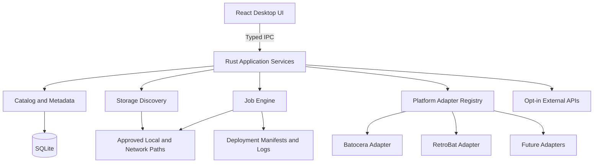

# 04 | Technical Architecture

## Baseline stack
- **Windows desktop:** Tauri v2, React, TypeScript, Vite.
- **Native services:** Rust, Tauri commands/events; no arbitrary shell execution from frontend.
- **Database:** SQLite in app-data folder; migrations and transactional writes.
- **UI state:** React with query/pagination patterns for large libraries.
- **External sources:** official upstream release/download APIs as supported; user-authorized metadata provider APIs.
- **Optional future:** NAS via mapped drive/SMB and authenticated remote agents, not required for local operation.

## Logical view


## Modules/interfaces
- `storage`: read-only physical/volume discovery, stable IDs, mount status, access permissions and protected-disk tagging.
- `catalog`: indexed roots, file metadata, game identity, deduplication and matching confidence.
- `platforms`: `PlatformAdapter` with `detect`, `capabilities`, `validateLayout`, `planFilePlacement`, `renderMetadata` and, later, `install`/`upgrade` gates.
- `deployment`: immutable plan, target validation, staging, verify, commit, resumable job journal.
- `metadata`: provider client, rate-limit/caching, provenance and manual editing.
- `maintenance`: check registry, diagnostics, repair plans, backup-first operations.
- `jobs`: state machine and cancellations; events for UI progress; durable log.
- `settings`: provider keys stored through platform secure storage as feasible; user-approved roots and options.

## Platform adapter contract (conceptual)
```typescript
interface PlatformAdapter {
  id: string;
  displayName: string;
  kind: 'bootable-os' | 'portable-app' | 'frontend';
  detectInstallation(root: string): Promise<DetectionResult>;
  validateLayout(root: string): Promise<ValidationResult>;
  planGameFiles(request: DeploymentRequest): Promise<PlannedFile[]>;
  capabilities(): AdapterCapabilities;
}
```
Installation and updates intentionally require independent, more privileged interfaces and separate threat reviews. Adapter IDs/versioning must remain stable across schema migrations.

## Job lifecycle
`queued -> preflight -> awaiting_confirmation -> running -> verifying -> committing -> completed` with branches to `paused`, `cancelling`, `cancelled`, `failed`, `recovery_required`. Persist state at safe boundaries so a restart can identify unfinished jobs. Write temporary files in target filesystem when possible; atomic rename on completion when supported; no manifest success before verification.

## Trust boundaries
Frontend is unprivileged. Rust services validate all command arguments. A future high-privilege disk helper, if needed, must use a narrow allowlist, per-operation user approval, a verified physical disk identity and no generic command interpreter.

## Performance and reliability
- Paginate game lists; index title/platform/status.
- Use incremental enumeration and background hash queues, not hash every multi-terabyte collection during first import.
- Store relative paths where possible with stable root identifiers.
- Handle Windows long paths, case-insensitive comparisons, network interruptions and filesystem permissions.
- Never update catalog to reflect a write until verified.

## State of existing scaffold
The starter currently uses a simpler file-centric SQLite schema and synchronous scan. Refactor in migrations; do not represent the target architecture as already shipped.
