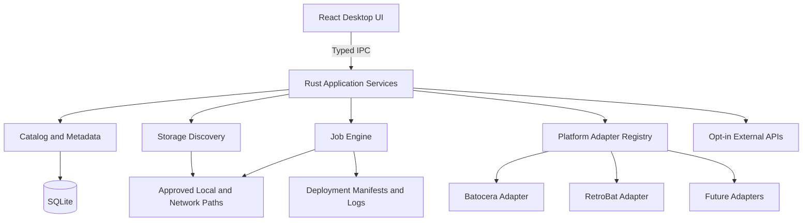

# 04 | Technical Architecture

## Baseline stack
- **Windows desktop:** Tauri v2, React, TypeScript, Vite.
- **Native services:** Rust, Tauri commands/events; no arbitrary shell execution from frontend.
- **Database:** SQLite in app-data folder; migrations and transactional writes.
- **UI state:** React with query/pagination patterns for large libraries.
- **External sources:** official upstream release/download APIs as supported; user-authorized metadata provider APIs.
- **Optional future:** NAS via mapped drive/SMB and authenticated remote agents, not required for local operation.

## Logical view


## Modules/interfaces
- `storage`: read-only physical/volume discovery, stable IDs, mount status, access permissions and protected-disk tagging.
- `catalog`: indexed roots, file metadata, game identity, deduplication and matching confidence.
- `platforms`: `PlatformAdapter` with `detect`, `capabilities`, `validateLayout`, `planFilePlacement`, `renderMetadata` and, later, `install`/`upgrade` gates.
- `deployment`: immutable plan, target validation, staging, verify, commit, resumable job journal.
- `metadata`: provider client, rate-limit/caching, provenance and manual editing.
- `maintenance`: check registry, diagnostics, repair plans, backup-first operations.
- `jobs`: state machine and cancellations; events for UI progress; durable log.
- `settings`: provider keys stored through platform secure storage as feasible; user-approved roots and options.

## Platform adapter contract (implemented as contract v1 in `src-tauri/src/adapters/mod.rs`; the TypeScript below is the original concept)
```typescript
interface PlatformAdapter {
  id: string;
  displayName: string;
  kind: 'bootable-os' | 'portable-app' | 'frontend';
  detectInstallation(root: string): Promise<DetectionResult>;
  validateLayout(root: string): Promise<ValidationResult>;
  planGameFiles(request: DeploymentRequest): Promise<PlannedFile[]>;
  capabilities(): AdapterCapabilities;
}
```
Installation and updates intentionally require independent, more privileged interfaces and separate threat reviews. Adapter IDs/versioning must remain stable across schema migrations.

## Job lifecycle
`queued -> preflight -> awaiting_confirmation -> running -> verifying -> committing -> completed` with branches to `paused`, `cancelling`, `cancelled`, `failed`, `recovery_required`. Persist state at safe boundaries so a restart can identify unfinished jobs. Write temporary files in target filesystem when possible; atomic rename on completion when supported; no manifest success before verification.

## Trust boundaries
Frontend is unprivileged. Rust services validate all command arguments. A future high-privilege disk helper, if needed, must use a narrow allowlist, per-operation user approval, a verified physical disk identity and no generic command interpreter.

## Performance and reliability
- Paginate game lists; index title/platform/status.
- Use incremental enumeration and background hash queues, not hash every multi-terabyte collection during first import.
- Store relative paths where possible with stable root identifiers.
- Handle Windows long paths, case-insensitive comparisons, network interruptions and filesystem permissions.
- Never update catalog to reflect a write until verified.

## Implemented today (updated 2026-11-04, M1 plus RDS-006/007)
Native backend modules in `src-tauri/src/`:

| Module | Responsibility | Target module above |
|---|---|---|
| `lib.rs` | Tauri setup and commands: `query_games`, `library_stats`, `list_adapters`, `inspect_installation`, `add_installation`, `list_installations`, `remove_installation`, `placement_preview`, `list_storage_locations`, `start_scan`, `cancel_job`, `active_scan`, `recent_jobs`, `list_drives`. At startup it migrates the catalog and recovers interrupted jobs; if that fails, every command returns the error. Holds the in-memory registry of running jobs and their cancel flags. | app services |
| `jobs.rs` | Durable job log: create, add events, finish, list recent, recover interrupted. | `jobs` |
| `adapters/mod.rs` | `PlatformAdapter` trait (contract v1, read-only), `registry()`, `detect_all()`, `catalog()` and `folder_name()` for Windows-safe names. | `platforms` |
| `adapters/retrobat.rs` | RetroBat detection, layout checks and placement rules, with facts cited from the RetroBat wiki in the module docs. | `platforms` |
| `installations.rs` | Inspect a folder, save, list and forget installations; `placement_preview` builds the read-only plan from the catalog. | `platforms` / `deployment` |
| `db.rs` | Opens connections (WAL, foreign keys, busy timeout). Versioned migrations via `PRAGMA user_version`, with a backup first and v0.1 data conversion. | `catalog` |
| `scanner.rs` | Read-only folder indexer. Commits in batches, reports progress and accepts cancellation through a `ScanObserver`. After the walk, a grouping pass reads `.cue` and `.m3u` files and links tracks and discs into one game. Returns a `ScanSummary` with errors and warnings kept separate. | `catalog` / `jobs` |
| `classify.rs` | Infers the platform from folder names and extensions, and records where the hint came from. | `catalog` |
| `catalog.rs` | Paged library queries (`query_games`) with search, filters, sort and duplicate counts; `library_stats`; Known drives list. | `catalog` |
| `paths.rs` | Path normalization without `\\?\`, even for paths over 260 characters (std re-adds the prefix internally), plus volume-root and relative-path splitting. | `storage` |
| `drives.rs` | Read-only volume listing (sysinfo); local/removable classification. | `storage` |
| `volumes.rs` | Volume fingerprints via Win32 `GetVolumeInformationW`, `GetDiskFreeSpaceExW` and `GetVolumeNameForVolumeMountPointW` (read only). `probe(root)` returns kind and identity; `presence(root, stable_id)` returns Connected / NotConnected / OtherVolume. | `storage` |

Behavior that differs from the target design, and is still open:
- **Scan jobs (RDS-002):** `start_scan` creates a `jobs` row, returns the job id right away, and runs the scan on a worker thread.
  - **Events to the UI:** `scan-progress` (at most every 200 ms) and `scan-finished` (state `completed` / `cancelled` / `failed`, with the summary or error).
  - **One at a time:** only one scan can run. A panic inside the scan is caught and recorded as `failed`, so the app can't get stuck in "scanning".
  - **Not built yet:** the full lifecycle above (preflight, awaiting_confirmation, verifying, committing, paused) waits for deployment jobs.
  - **New state:** `interrupted`, for jobs found still `running` at startup (ADR-013).
- **Connections:** each command opens its own SQLite connection, with no pool.
- **Commands** return errors as plain strings; structured error codes are still to come.
- **Library queries (RDS-004)** run in two phases.
  - **Phase 1** finds one page of file-location ids. It uses a fixed join order (`CROSS JOIN`) so SQLite walks an index already in the requested order: games by title or platform+title, or files by size. It stops after the page instead of sorting the whole library.
  - **Phase 2** loads details, availability and duplicate counts for just those rows.
  - **Search** uses the `games_fts` trigram index for 3+ characters and `LIKE` for shorter text.
  - **Counts:** filtered totals stop at 10,000 (`total_capped`); the unfiltered total is exact.
  - **Availability** for filters comes from one presence check per storage location, passed into SQL as a JSON list of offline locations.
  - **Primary files only:** the library lists only primary files (`+gf.file_role = 'primary'`; the unary `+` keeps SQLite from picking the role index for that term). Discs and tracks appear as `disc_count`, the total `file_size`, and `incomplete`.
  - **Invariant:** every `game_files` row has exactly one `file_locations` row, so primary files are counted straight from the role index.
- **Availability** comes from the last scan, plus one presence check per volume (reachable *and* the same fingerprint). Listing never checks individual files.
- **Drive matching** (`db::resolve_storage_location`) goes by fingerprint first. Next, it claims an older unidentified location at the same root, but only if sampled files from that location exist on the volume. Otherwise it creates a new location. There is no confirmation prompt yet, because scans never write to drives; deployment will add one (QA-015).
- **Security policy:** `tauri.conf.json` still has `csp: null`.
