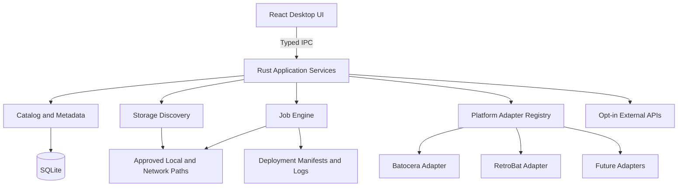

# 04 | Technical Architecture

## Baseline stack
- **Windows desktop:** Tauri v2, React, TypeScript, Vite.
- **Native services:** Rust, Tauri commands/events; no arbitrary shell execution from frontend.
- **Database:** SQLite in app-data folder; migrations and transactional writes.
- **UI state:** React with query/pagination patterns for large libraries.
- **External sources:** official upstream release/download APIs as supported; user-authorized metadata provider APIs.
- **Optional future:** NAS via mapped drive/SMB and authenticated remote agents, not required for local operation.

## Logical view


## Modules/interfaces
- `storage`: read-only physical/volume discovery, stable IDs, mount status, access permissions and protected-disk tagging.
- `catalog`: indexed roots, file metadata, game identity, deduplication and matching confidence.
- `platforms`: `PlatformAdapter` with `detect`, `capabilities`, `validateLayout`, `planFilePlacement`, `renderMetadata` and, later, `install`/`upgrade` gates.
- `deployment`: immutable plan, target validation, staging, verify, commit, resumable job journal.
- `metadata`: provider client, rate-limit/caching, provenance and manual editing.
- `maintenance`: check registry, diagnostics, repair plans, backup-first operations.
- `jobs`: state machine and cancellations; events for UI progress; durable log.
- `settings`: provider keys stored through platform secure storage as feasible; user-approved roots and options.

## Platform adapter contract (implemented, now contract v3, in `src-tauri/src/adapters/mod.rs`; the TypeScript below is the original concept)
```typescript
interface PlatformAdapter {
  id: string;
  displayName: string;
  kind: 'bootable-os' | 'portable-app' | 'frontend';
  detectInstallation(root: string): Promise<DetectionResult>;
  validateLayout(root: string): Promise<ValidationResult>;
  planGameFiles(request: DeploymentRequest): Promise<PlannedFile[]>;
  capabilities(): AdapterCapabilities;
}
```
Installation and updates intentionally require independent, more privileged interfaces and separate threat reviews. Adapter IDs/versioning must remain stable across schema migrations.

## Job lifecycle
`queued -> preflight -> awaiting_confirmation -> running -> verifying -> committing -> completed` with branches to `paused`, `cancelling`, `cancelled`, `failed`, `recovery_required`. Persist state at safe boundaries so a restart can identify unfinished jobs. Write temporary files in target filesystem when possible; atomic rename on completion when supported; no manifest success before verification.

## Trust boundaries
Frontend is unprivileged. Rust services validate all command arguments. The `rdmedia` protocol serves only images already linked to a game in the catalog (never a path supplied by the page). The only file writes are the copier's (docs/18): user-confirmed, scoped to one installation, never overwriting or deleting, never through links, and re-checked against the reviewed plan's fingerprint and the drive's identity. A future high-privilege disk helper, if needed, must use a narrow allowlist, per-operation user approval, a verified physical disk identity and no generic command interpreter.

## Performance and reliability
- Paginate game lists; index title/platform/status.
- Use incremental enumeration and background hash queues, not hash every multi-terabyte collection during first import.
- Store relative paths where possible with stable root identifiers.
- Handle Windows long paths, case-insensitive comparisons, network interruptions and filesystem permissions.
- Never update catalog to reflect a write until verified.

## Implemented today (updated 2026-11-05, M1 plus RDS-006/007/009/010)
Native backend modules in `src-tauri/src/`:

| Module | Responsibility | Target module above |
|---|---|---|
| `lib.rs` | Tauri setup and commands: `query_games`, `library_stats`, `system_summary`, `import_reference`, `reference_status`, `remove_reference`, `set_game_art`, `remove_game_art`, `set_left_out`, `list_backups`, `undo_replace`, `open_backup_folder`, `emulator_settings`, `preview_emulator_settings`, `list_designs`, `create_design`, `save_design_draft`, `finish_design`, `abandon_design`, `delete_design`, `music_settings`, `preview_design`, `apply_design`, `design_applications`, `undo_design_application`, `look_options`, `preview_look`, `apply_look`, `add_retrobat_media`, `list_themes`, `theme_preview_asset`, `create_theme_remix`, `preview_theme_switch`, `apply_theme_switch`, `apply_emulator_settings`, `emulator_settings_history`, `undo_emulator_settings`, `duplicate_cleanup_preview`, `clean_up_duplicates`, `list_collections`, `create_collection`, `rename_collection`, `delete_collection`, `add_to_collection`, `remove_from_collection`, plus the `rdmedia` image protocol, `list_adapters`, `inspect_installation`, `add_installation`, `list_installations`, `remove_installation`, `set_arcade_system`, `deployment_plan`, `start_deployment`, `list_storage_locations`, `start_scan`, `cancel_job`, `active_scan`, `recent_jobs`, `list_drives`. At startup it migrates the catalog and recovers interrupted jobs; if that fails, every command returns the error. Holds the in-memory registry of running jobs and their cancel flags. | app services |
| `jobs.rs` | Durable job log: create, add events, finish, list recent, recover interrupted. | `jobs` |
| `adapters/mod.rs` | `PlatformAdapter` trait (contract v3, read-only; v2 adds `PlacementOptions` such as the arcade choice to each request; v3 adds `Capabilities::copy_games`, which the copier requires, and `Detection::hint` for near misses), shared helpers `has_entry` and `plan_in_roms`, `registry()`, `detect_all()`, `catalog()` and `folder_name()` for Windows-safe names. | `platforms` |
| `adapters/retrobat.rs` | RetroBat detection, layout checks and placement rules, with facts cited from the RetroBat wiki in the module docs. Its system-folder map is shared with Batocera. | `platforms` |
| `adapters/batocera.rs` | Batocera (RDS-008): detection of the game folder (`\\BATOCERA\share` or `<drive>\batocera`), hints for the boot partition, layout checks and placement previews. `copy_games: false`. | `platforms` |
| `installations.rs` | Inspect a folder, save, list and forget installations. | `platforms` |
| `deployment.rs` | RDS-009 deployment plan (read-only): places every available game with the adapter, classifies each destination file (copy, already there, already in place, duplicate, conflict, blocked), measures capacity and returns a plan fingerprint. Only reads metadata; never creates or writes. | `deployment` |
| `collections.rs` | The user's collections: list, create, rename, delete, add and remove games (catalog lists only). | `collections`, `collection_games` |
| `designs.rs` | Designs: named RetroBat customizations (theme choice/remix, retrobat.ini options, own video, music settings and tracks, per-system settings) kept in the catalog as finished spec + draft; seed from an installation; preview and apply as one step (files first, then es_settings.cfg and retrobat.ini through `customizer::write_file`, rolling back the first if the second fails); undo an application. | `designs`, `design_applications` |
| `gamelists.rs` | Game art and details in RetroBat's `roms/<system>/gamelist.xml` for games RetroDrive copied (`preview`, `apply`): picks the user's art (own pick > box art > image; thumbnail and marquee separately) and reference-catalog details, adds only missing tags/entries as minimal text edits, copies images as new files (temp, SHA-256 read-back, no-replace), writes lists through `customizer::write_file`, records a `design_applications` row for undo. File checks and image copies run 16 at a time (`parallel_map`; on a network share each check mostly waits on the network: 4,034 games went from 10 minutes to 24 seconds on the owner's NAS, 2026-11-07); an image already at the target name is compared by size before contents. Commands `preview_retrobat_art`, `apply_retrobat_art` (both emit `art-progress` `{phase: checking|copying, done, total}`); `start_deployment` takes `add_art` and runs it after the copy (`deploy-finished.art`). |
| Sync (2026-11-07, ADR-043) | `deployment::plan_sync` (the sync scope; ADR-045), `mark_removed` (games copied before and now gone: `removed` / `kept_off`), `installations::{sync_skip, set_sync_skip, kept_off, set_kept_off}`; commands `sync_plan`, `set_sync_skip`, `set_kept_off`; the copy itself is the normal `start_deployment` with `add_art`. `copier::still_confirmed` skips re-reading an already-there file confirmed earlier and unchanged since. |
| Choices (2026-11-07, ADR-044) | `src/Decisions.tsx` (`DecisionsLine`, `DecisionsPanel`: groups plan lists by choice situation, per-row and "for all" choices); `installations::{saved_choices, set_saved_choices}` and commands `saved_choices`, `set_saved_choices` (`installations.choices_json`; *replace* never saved). `App.tsx` loads saved choices when a plan or Sync opens and saves on every change; the copier receives the same map as before. |
| Sync scope (2026-11-07, ADR-045) | `deployment::{sync_scope, add_to_sync_scope}` (saved scope, or derived from copied games still on the drive), `build(..., scope, ...)` filters to scope systems ∪ scope collections' games; `mark_removed` relabels conflicts on previously copied files as `changed`. `installations::{SyncScope, saved_sync_scope, set_sync_scope}`; commands `sync_scope`, `set_sync_scope`; `start_deployment(sync)` → `DeployRequest.sync` (the copier rebuilds the sync plan); `run_deployment` adds a plan copy's systems or collection to the scope after it finishes (completed, with issues, or cancelled with something copied). `sync_skip` removed. |
| Batocera art and Sync (2026-11-07, ADR-047) | `gamelists::GAMELIST_PLATFORMS` (`retrobat`, `batocera`); `customizer::install_for` (game lists accept both; `install` stays RetroBat-only for settings); `customizer::never_running` and `lib.rs` `running_for` (Batocera never blocks on a local process) and `batocera_note` (Update Gamelists tip); `undo_design_application` uses the installation's running check. UI: `GAMELIST_PLATFORMS` in `App.tsx` (Sync button, add art on copy), `Customize.tsx` (Batocera: art and applied designs only). |
| Batocera settings (2026-11-07, ADR-048) | `batocera_settings.rs`: `settings` (offered keys and values), `conf_values`/`conf_edit` (line edits like Batocera's `SystemConf::saveSystemConf`, verified to change only the wanted keys), `options`, `preview`/`apply`, `preview_theme`/`apply_theme`; writes through `customizer::write_file` (journal, backup, undo, recovery). Commands `batocera_options`, `preview_batocera_settings`, `apply_batocera_settings`, `preview_batocera_theme`, `apply_batocera_theme`; `undo_emulator_settings` now uses the installation's running check. UI: `src/BatoceraSettings.tsx`. |
| Install helper (2026-11-07, ADR-049) | `install_helper.rs`: `inspect` (magic bytes: gzip, xz with footer check, zip, raw disk image by MBR signature; size; name → system, version, hardware), `checksum` (SHA-256 or MD5 by length; progress), `writers`/`open_writer` (Raspberry Pi Imager or balenaEtcher found only in their install folders; image passed as one argument), `open_download_page` (fixed official URLs). Commands `install_image_info`, `install_checksum` (event `install-hash`), `install_writers`, `open_install_writer`, `open_download_page`. UI: `src/InstallHelper.tsx`. New dependency `md-5`. |
| RetroPie adapter (2026-11-07, ADR-050) | `adapters/retropie.rs` (detect, validate, plan with `retropie_folder` over `retrobat::system_folder`), `adapters::plan_in(prefix, …)` (`plan_in_roms` = `plan_in("roms/", …)`), `PlacementOptions.has_roms_folder` (set in `installations::located`), `DeploymentPlan.systems_prefix`. |
| RetroPie Sync and art (2026-11-07, ADR-052) | `gamelists::GAMELIST_PLATFORMS` includes `retropie`; `games_dir` (system folders at `roms\` or the root); `plan(…, create_lists, …)` skips RetroPie systems without a rom-folder list unless asked (`ArtPreview.lists_not_created`); commands `preview_retrobat_art`/`apply_retrobat_art` take `create_lists`; `run_deployment` never creates lists; `running_for`/`batocera_note` cover RetroPie. UI: `GAMELIST_PLATFORMS` in `App.tsx`, opt-in box in `Customize.tsx`. |
| RetroPie settings (2026-11-07, ADR-053) | `retropie_settings.rs`: `configs_root` (`\\host\roms` → `\\host\configs`), `parse`/`set_default` (only the `default` line; checked), `options`, `preview`, `apply` (per-file SHA check; `customizer::write_file` with the configs share as root, no stable id; rollback if one fails). Commands `retropie_options`, `preview_retropie_emulators`, `apply_retropie_emulators`. UI: `src/RetroPieSettings.tsx`. Undo messages no longer name RetroBat. |
| ES-DE adapter (2026-11-07, ADR-054) | `adapters/esde.rs` (detect with `has_esde_markers`, `rom_directory_setting`; validate; plan with `esde_folder` over `retrobat::system_folder`, `plan_in("")`); RetroPie's detect returns NotDetected on ES-DE markers; `DeploymentPlan.systems_prefix` empty for ES-DE. |
| BIOS files (2026-11-07, ADR-056) | `classify::classify` (anything under a `bios` folder is BIOS, `BIOS_SKIP`), `PlacementRequest.bios_path` (set in `deployment::gather` from the path below the first `bios` segment), `adapters::plan_bios(folder, …)` (keeps subfolders; refuses `..`, housekeeping files and `[BIOS]` archives); used by RetroBat/Batocera (`bios`), RetroPie with `has_roms_folder` (`BIOS`); RetroPie share and ES-DE return reasons. |
| ES-DE art (2026-11-07, ADR-057) | `gamelists::Layout` (`InFolder` / `EsDe { data, media }`), `esde_data_dir`, `esde_media_dir`, `esde_has_media`; `plan_system` writes ES-DE lists without image tags and plans `covers`/`marquees` copies; `apply` journals ES-DE lists with the data folder as root and skips unchanged lists. `customizer::esde_running` / `any_running` (process walk shared with `retrobat_running`); `lib.rs` `running_for` uses it for ES-DE. |
| Recalbox adapter (2026-11-07, ADR-058) | `adapters/recalbox.rs` (`has_recalbox_conf`, detect, validate, plan with `recalbox_folder` over `retrobat::system_folder`, `plan_in_roms`, `plan_bios("bios")`); Batocera, RetroPie and ES-DE return NotDetected on `recalbox.conf`. |
| `themes.rs` | RetroBat themes: list them with their color/picture variables (as RetroBat applies them by default), fonts, size and credits; remix one into a new folder (temporary name, renamed when complete; only the copy is edited); preview assets as data URLs. | files only |
| `customizer.rs` | RetroBat customization: emulator settings (es_settings.cfg), boot video and frontend options (retrobat.ini, curated list), adding the user's own video/music as new files, theme switch; one journaled write path (`write_file`) for every file. Emulator settings (RDS-021 v1): read the install's choices and current values, validate a change, edit `es_settings.cfg` minimally, apply with backup (journaled, read back, no-replace renames), undo, crash repair; detects a running RetroBat. | `settings_changes` |
| `restore.rs` | Backups made by Replace: list them per installation, undo a replace (verified swap, journaled, never deletes) and repair an interrupted undo at startup. Uses the copier's no-replace rename and folder checks. | `deployment_items` |
| `duplicates.rs` | Leave files out of the library / bring them back (catalog marks only), and duplicate cleanup with a deterministic keep-one rule and a preview. | `catalog` |
| `media.rs` | Game images: reads `gamelist.xml` (quick-xml), folder conventions, the user's own picks; resolves the best image for the `rdmedia` protocol (recorded images only, image types, 25 MB cap, connected drives). Scans call it from `scanner.rs` to link art. | `catalog` |
| `reference.rs` | The user's reference catalog: reads `.xlsx` (calamine) or `.csv`, maps columns by header (never art), imports into separate tables, and links library games by No-Intro/MAME name, MAME clone set, then title per system; rematches new games after each scan. | `catalog` |
| `copier.rs` | RDS-010 staged copier, the only code that writes game files (since 2026-11-06 up to 4 games at once on worker threads; every journal write goes through the main thread and is confirmed before the worker continues; files ≥ 32 MB one at a time): re-checks the plan fingerprint, volume identity and space; journals every item (`deployments`, `deployment_items`); streams each file to a `.rdpart-` temp with SHA-256, syncs, reads it back past the cache, and commits with a rename that refuses to replace; compares "already there" files by content; writes a manifest; recovers and cleans interrupted copies at startup. Rules and evidence: docs/18. | `deployment` |
| `db.rs` | Opens connections (WAL, foreign keys, busy timeout). Versioned migrations via `PRAGMA user_version`, with a backup first and v0.1 data conversion. | `catalog` |
| `scanner.rs` | Read-only folder indexer. Commits in batches, reports progress and accepts cancellation through a `ScanObserver`. After the walk, a grouping pass reads `.cue` and `.m3u` files and links tracks and discs into one game. Returns a `ScanSummary` with errors and warnings kept separate. | `catalog` / `jobs` |
| `classify.rs` | Infers the platform from folder names and extensions, and records where the hint came from. | `catalog` |
| `catalog.rs` | Paged library queries (`query_games`) with search, filters, sort and duplicate counts; `library_stats`; Known drives list. | `catalog` |
| `paths.rs` | Path normalization without `\\?\`, even for paths over 260 characters (std re-adds the prefix internally), plus volume-root and relative-path splitting. | `storage` |
| `drives.rs` | Read-only volume listing (sysinfo); local/removable classification. | `storage` |
| `volumes.rs` | Volume fingerprints via Win32 `GetVolumeInformationW`, `GetDiskFreeSpaceExW` and `GetVolumeNameForVolumeMountPointW` (read only). `probe(root)` returns kind and identity; `presence(root, stable_id)` returns Connected / NotConnected / OtherVolume. | `storage` |

Behavior that differs from the target design, and is still open:
- **Scan jobs (RDS-002):** `start_scan` creates a `jobs` row, returns the job id right away, and runs the scan on a worker thread.
  - **Events to the UI:** `scan-progress` (at most every 200 ms) and `scan-finished` (state `completed` / `cancelled` / `failed`, with the summary or error).
  - **One at a time:** only one scan can run. A panic inside the scan is caught and recorded as `failed`, so the app can't get stuck in "scanning".
  - **Not built yet:** the full lifecycle above (preflight, awaiting_confirmation, verifying, committing, paused) waits for deployment jobs.
  - **New state:** `interrupted`, for jobs found still `running` at startup (ADR-013).
- **Connections:** each command opens its own SQLite connection, with no pool.
- **Commands** return errors as plain strings; structured error codes are still to come.
- **Library queries (RDS-004)** run in two phases.
  - **Phase 1** finds one page of file-location ids. It uses a fixed join order (`CROSS JOIN`) so SQLite walks an index already in the requested order: games by title or platform+title, or files by size. It stops after the page instead of sorting the whole library.
  - **Phase 2** loads details, availability and duplicate counts for just those rows.
  - **Search** uses the `games_fts` trigram index for 3+ characters and `LIKE` for shorter text.
  - **Counts:** filtered totals stop at 10,000 (`total_capped`); the unfiltered total is exact.
  - **Availability** for filters comes from one presence check per storage location, passed into SQL as a JSON list of offline locations.
  - **Primary files only:** the library lists only primary files (`+gf.file_role = 'primary'`; the unary `+` keeps SQLite from picking the role index for that term). Discs and tracks appear as `disc_count`, the total `file_size`, and `incomplete`.
  - **Invariant:** every `game_files` row has exactly one `file_locations` row, so primary files are counted straight from the role index.
- **Availability** comes from the last scan, plus one presence check per volume (reachable *and* the same fingerprint). Listing never checks individual files.
- **Drive matching** (`db::resolve_storage_location`) goes by fingerprint first. Next, it claims an older unidentified location at the same root, but only if sampled files from that location exist on the volume. Otherwise it creates a new location. There is no confirmation prompt yet, because scans never write to drives; deployment will add one (QA-015).
- **Security policy:** `tauri.conf.json` still has `csp: null`.
