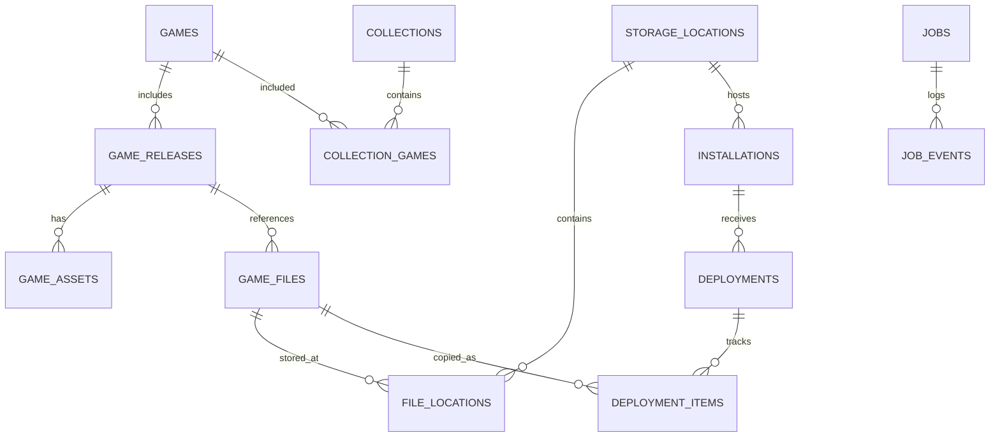

# 05 | Hybrid Library Data Model

## Essential rule
**Game identity is not a file and is not a deployment.** A game may have multiple editions/discs/files; one file can be stored in many physical places; a selected subset can be deployed to many platform installations. Offlining storage must not delete canonical game records.

## Relationships

## Proposed tables

| Table | Minimum fields / purpose |
|---|---|
| `games` | `id`, canonical_title, platform_family, created_at, updated_at |
| `game_releases` | `id`, game_id, region, version, publisher, release_date, media_type, match_confidence |
| `game_files` | `id`, release_id nullable, filename, size_bytes, sha256 nullable, crc32 nullable, file_type, disc_index nullable |
| `storage_locations` | `id`, type(local/removable/network), stable_id nullable, display_name, root_hint, last_seen_at, online_status |
| `file_locations` | `id`, game_file_id, storage_location_id, relative_path, last_seen_at, present_status, last_verified_at |
| `installations` | `id`, storage_location_id, adapter_id, adapter_version, path, version_string, state |
| `collections` | `id`, name, kind, created_at |
| `collection_games` | `collection_id`, `game_id`, sort_order |
| `deployments` | `id`, installation_id, collection_id nullable, plan_hash, created_at, completed_at, status |
| `deployment_items` | `id`, deployment_id, game_file_id, source_location_id, destination_relpath, expected_hash, outcome |
| `metadata_providers` | `id`, provider_name, authorization_ref nullable, rate_limit_state |
| `game_assets` | `id`, game_release_id, asset_kind, provider_id, local_cache_path, license_info nullable, attribution nullable |
| `bios_requirements` | `id`, adapter_id, system_code, filename_hint, known_hash nullable, requirement_level |
| `profiles` | `id`, name, adapter_id nullable, schema_version, json_data, created_at |
| `jobs` | `id`, kind, state, input_json, progress_json, started_at, finished_at, error_code nullable |
| `job_events` | `id`, job_id, event_time, severity, event_code, detail_json |
| `backups` | `id`, backup_kind, source_ref, destination_ref, manifest_path, verified_at nullable |

## Keys and constraints
- All identifiers are UUID/ULID-like opaque strings; don't key by filenames.
- Unique file location within a storage root: `(storage_location_id, relative_path)` after normalized path handling.
- Use `ON DELETE RESTRICT` or explicit transactional cleanup for important references; do not cascade offline drive removal into games.
- Full-text search on titles with SQLite FTS5 when implemented; migration compatibility tests required.
- `sha256` nullable because hashing large libraries is deferred and incremental.
- Different revisions with identical names may remain separate release/file entities.
- Handle multi-file formats and multidisc playlists explicitly; don't assume a `.cue` or `.m3u` is the entire game payload.

## Drive identifiers
For removable devices, maintain an OS-visible stable identifier where available plus secondary signals such as label, capacity and known file signatures. Drive letters are *not* stable identifiers. On ambiguous reattachment, require confirmation before writing.

## Import strategy
1. Add root with explicit user authorization.
2. Enumerate paths and record immutable observed facts.
3. Infer platform hints from source-root folder and extension; mark ambiguity.
4. Resolve games/releases with provider-assisted or manual matching, never merge solely by title.
5. Mark missing files offline after completed scans, not while a scan is interrupted.
6. Hash incrementally to help dedupe, preserving distinct formats/revisions.

## Implemented schema (v1, RDS-001, 2026-11-04)
Source of truth: `SCHEMA_V1` in `src-tauri/src/db.rs`. Built so far: `storage_locations`, `indexed_roots`, `games`, `game_releases`, `game_files` and `file_locations`. The other tables in the list above are still proposals.

Choices made while implementing (see ADR-010 and ADR-011 in docs/13):
- **`storage_locations` is one row per volume root** (`C:\`, `\\server\share\`, `/`). It is not a row per scanned folder. `kind` is `local` / `removable` / `network` / `unknown`; `stable_id` stays empty until RDS-003.
- **`indexed_roots` (new table)** holds the folders the user authorized: a storage location plus a relative path, with the last scan's start and end times and its status. Rescanning a folder inside an earlier root reuses the same storage location, so files are never duplicated.
- **`file_locations.relative_path`** is relative to the volume root, always uses `/`, and compares case-insensitively (`COLLATE NOCASE`). It is unique per storage location. `last_scan_id` records which scan last saw the file, and `present_status` is `present` or `missing`.
- **`game_files.platform_hint` / `platform_hint_source`** (`folder` / `extension` / `ambiguous` / `legacy`) record how confident the platform guess is.
- **One game per file for now:** each newly found file gets its own `games` row and an unmatched `game_releases` row. Nothing is merged by title. Grouping discs and playlists, and matching games, are later work.
- **IDs** are random UUID v4 strings.
- **Timestamps** are SQLite `CURRENT_TIMESTAMP` text (UTC). `modified_at` is in Unix seconds.

## Implemented schema v2 (RDS-002, 2026-11-04)
- **`jobs`:** `id`, `kind` (`library_scan`), `state` (`running` / `completed` / `cancelled` / `failed` / `interrupted`), `input_json`, `progress_json` (final counts), `started_at`, `finished_at`, `error_code`, `error_message`.
- **`job_events`:** `id`, `job_id`, `event_time`, `severity` (`info` / `warning` / `error`), `event_code` (`started`, `completed`, `cancelled`, `failed`, `interrupted`, `scan_issue`), `detail_json`.
- **`indexed_roots.last_scan_status`** now also takes `cancelled` and `interrupted`.
- **v1 → v2:** adds the two tables (with a backup first, like every upgrade). Tested by `db::tests::v1_catalog_upgrades_to_v2_keeping_data`, and run for real on a live v1 catalog on 2026-11-04.

## Migrations
- The version number is kept in `PRAGMA user_version`; the current version is `db::SCHEMA_VERSION`.
- On startup, a catalog older than the app is first copied with `VACUUM INTO` to `retrodrive.sqlite.v<N>-backup-<unix time>`. It is then upgraded in a single transaction.
- **v0 → v1:** the v0.1 `game_files` table is renamed, and every row becomes a storage location, game, release, file and location. The stored path has its `\\?\` prefix removed and is split by volume; legacy rows are stored as `present`. The migration aborts and rolls back unless the file-location count equals the legacy row count. The legacy table is dropped only after that check passes.
- A catalog with a newer version than the app is refused and left unchanged.
- Tests: `db::tests` covers a fresh catalog, running twice, refusing a newer catalog, and a v0 upgrade with the backup checked (QA-017).
