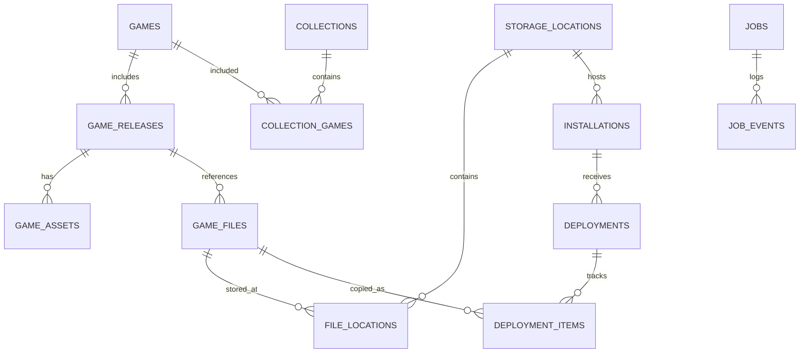

# 05 | Hybrid Library Data Model

**Image normalization:** no source/catalog change. The pure codec returns bytes/hash/dimensions and assets/images/<hash>.png compatible with the existing asset path contract. No asset row/document declaration is persisted yet; provenance/license and managed storage are still unwired.

**Layer editor flags:** optional node.editor object contains locked/hidden booleans (absent means false). Extra fields survive flag updates. Non-object editor data or non-boolean known flags are read-only. Flags persist in the existing project JSON/checkpoint/draft without a schema or SQLite migration; this is editor-preview state, not native visibility/conditions.

**Grid/snapping:** visibility, enabled state and spacing live only in the mounted canvas session. They are not portable source fields or database columns. Only completed moves/resizes use existing source dimensions and serialized persistence. No source or SQLite migration.

**Resize:** existing layout.width/height fields retain px/% units and opaque dimension fields. Changed sizes have a one-logical-pixel gesture minimum and the existing 1,000,000 source-unit maximum; positive rounding floor is 0.000001. Unchanged axes retain original precision. No SQLite/source migration.

**Alignment:** only existing layout.x or layout.y changes. Original px/% units and extension fields remain intact; geometry rounds to six source-unit decimals. Positions outside the existing +/-1,000,000 source-unit limit are refused instead of clamped. No source/catalog migration.

**Transform authoring:** existing layout.rotation and style.opacity fields are now editable for supported leaf layers. Rotation accepts finite degrees within +/-36,000; opacity accepts 0..1 and defaults to 1 when absent. Unknown/out-of-range opacity source is read-only. No source or SQLite migration.

**Canvas layer order:** the existing scene.nodes array stores editor back-to-front order for flat text/panel scenes. Reordering changes only array placement, preserving IDs, payloads, extensions and other scenes. No catalog/source schema migration; native exporter ordering is not verified.

**Canvas increment:** universal source stays v1.0.0 and catalog stays v27. Original text/panel additions reuse node/layout/style contracts; supported style extension fields are text, color/fill and pixel fontSize. Unknown data remains intact. Session history is transient and separate from saved checkpoint/draft JSON; undo never rewrites a checkpoint implicitly.

**Catalog v27 (Theme Studio PR 2):** adds only `theme_projects(id, name, schema_version, saved_json, draft_json, revision, created_at, updated_at, saved_at)` and a recent-project index. SQL enforces source/record ID/version and indexed-name consistency, JSON validity and safe integer revision. The existing backup-first transactional migration preserves legacy tables. See [storage semantics](theme-studio/persistence.md); universal source version remains 1.0.0.

**Catalog v28 (ADR-097):** indexes `idx_game_files_parent` on `game_files(parent_file_id)` and `idx_deployment_items_file` on `deployment_items(game_file_id)`, so removing entries doesn't scan every file per row. No table or data change.

**Theme Studio PR 1 (2026-11-08):** versioned universal [JSON contract](theme-studio/project-format.md), separate from legacy DesignSpec. No catalog schema version, tables, designs or migrations change. SQLite remains the planned authoritative working store in PR 2. Portable source excludes machine paths/local installation bindings; its format schema version is independent of PRAGMA user_version.

## Essential rule
**Game identity is not a file and is not a deployment.** A game may have multiple editions/discs/files; one file can be stored in many physical places; a selected subset can be deployed to many platform installations. Offlining storage must not delete canonical game records.

## Relationships

## Proposed tables

| Table | Minimum fields / purpose |
|---|---|
| `games` | `id`, canonical_title, platform_family, created_at, updated_at |
| `game_releases` | `id`, game_id, region, version, publisher, release_date, media_type, match_confidence |
| `game_files` | `id`, release_id nullable, filename, size_bytes, sha256 nullable, crc32 nullable, file_type, disc_index nullable |
| `storage_locations` | `id`, type(local/removable/network), stable_id nullable, display_name, root_hint, last_seen_at, online_status |
| `file_locations` | `id`, game_file_id, storage_location_id, relative_path, last_seen_at, present_status, last_verified_at |
| `installations` | `id`, storage_location_id, adapter_id, adapter_version, path, version_string, state |
| `collections` | `id`, name, kind, created_at |
| `collection_games` | `collection_id`, `game_id`, sort_order |
| `deployments` | `id`, installation_id, collection_id nullable, plan_hash, created_at, completed_at, status |
| `deployment_items` | `id`, deployment_id, game_file_id, source_location_id, destination_relpath, expected_hash, outcome |
| `metadata_providers` | `id`, provider_name, authorization_ref nullable, rate_limit_state |
| `game_assets` | `id`, game_release_id, asset_kind, provider_id, local_cache_path, license_info nullable, attribution nullable |
| `bios_requirements` | `id`, adapter_id, system_code, filename_hint, known_hash nullable, requirement_level |
| `profiles` | `id`, name, adapter_id nullable, schema_version, json_data, created_at |
| `jobs` | `id`, kind, state, input_json, progress_json, started_at, finished_at, error_code nullable |
| `job_events` | `id`, job_id, event_time, severity, event_code, detail_json |
| `backups` | `id`, backup_kind, source_ref, destination_ref, manifest_path, verified_at nullable |

## Keys and constraints
- All identifiers are UUID/ULID-like opaque strings; don't key by filenames.
- Unique file location within a storage root: `(storage_location_id, relative_path)` after normalized path handling.
- Use `ON DELETE RESTRICT` or explicit transactional cleanup for important references; do not cascade offline drive removal into games.
- Full-text search on titles with SQLite FTS5: implemented in schema v4 (trigram tokenizer), with migration tests.
- `sha256` nullable because hashing large libraries is deferred and incremental.
- Different revisions with identical names may remain separate release/file entities.
- Handle multi-file formats and multidisc playlists explicitly; don't assume a `.cue` or `.m3u` is the entire game payload.

## Drive identifiers
For removable devices, maintain an OS-visible stable identifier where available plus secondary signals such as label, capacity and known file signatures. Drive letters are *not* stable identifiers. On ambiguous reattachment, require confirmation before writing.

*Implemented (RDS-003):* volume serial plus size as `stable_id`, with label, filesystem and GUID stored as secondary signals; see "Implemented schema v3" below. The confirmation step is deferred until a feature writes to drives.

## Import strategy
1. Add root with explicit user authorization.
2. Enumerate paths and record immutable observed facts.
3. Infer platform hints from source-root folder and extension; mark ambiguity.
4. Resolve games/releases with provider-assisted or manual matching, never merge solely by title.
5. Mark missing files offline after completed scans, not while a scan is interrupted.
6. Hash incrementally to help dedupe, preserving distinct formats/revisions.

## Implemented schema (v1, RDS-001, 2026-11-04)
Source of truth: `SCHEMA_V1` in `src-tauri/src/db.rs`. Built so far: `storage_locations`, `indexed_roots`, `games`, `game_releases`, `game_files` and `file_locations`. The other tables in the list above are still proposals.

Choices made while implementing (see ADR-010 and ADR-011 in docs/13):
- **`storage_locations` is one row per volume root** (`C:\`, `\\server\share\`, `/`). It is not a row per scanned folder. `kind` is `local` / `removable` / `network` / `unknown`; `stable_id` stays empty until RDS-003.
- **`indexed_roots` (new table)** holds the folders the user authorized: a storage location plus a relative path, with the last scan's start and end times and its status. Rescanning a folder inside an earlier root reuses the same storage location, so files are never duplicated.
- **`file_locations.relative_path`** is relative to the volume root, always uses `/`, and compares case-insensitively (`COLLATE NOCASE`). It is unique per storage location. `last_scan_id` records which scan last saw the file, and `present_status` is `present` or `missing`.
- **`game_files.platform_hint` / `platform_hint_source`** (`folder` / `extension` / `ambiguous` / `legacy`) record how confident the platform guess is.
- **One game per file for now:** each newly found file gets its own `games` row and an unmatched `game_releases` row. Nothing is merged by title. Grouping discs and playlists, and matching games, are later work.
- **IDs** are random UUID v4 strings.
- **Timestamps** are SQLite `CURRENT_TIMESTAMP` text (UTC). `modified_at` is in Unix seconds.

## Implemented schema v2 (RDS-002, 2026-11-04)
- **`jobs`:** `id`, `kind` (`library_scan`), `state` (`running` / `completed` / `cancelled` / `failed` / `interrupted`), `input_json`, `progress_json` (final counts), `started_at`, `finished_at`, `error_code`, `error_message`.
- **`job_events`:** `id`, `job_id`, `event_time`, `severity` (`info` / `warning` / `error`), `event_code` (`started`, `completed`, `cancelled`, `failed`, `interrupted`, `scan_issue`), `detail_json`.
- **`indexed_roots.last_scan_status`** now also takes `cancelled` and `interrupted`.
- **v1 → v2:** adds the two tables (with a backup first, like every upgrade). Tested by `db::tests::v1_catalog_upgrades_to_v2_keeping_data`, and run for real on a live v1 catalog on 2026-11-04.

## Implemented schema v3 (RDS-003, 2026-11-04)
- **`storage_locations` rebuilt** using SQLite's documented table-rebuild procedure: foreign keys are switched off outside the transaction, then `pragma_foreign_key_check` must pass before commit.
  - `stable_id` is now `UNIQUE`; `root_path` (the last known mount) is no longer unique and has an index.
  - New columns: `volume_label`, `filesystem`, `volume_serial`, `volume_guid`, `total_bytes`. `display_name` becomes `LABEL (E:\)` when the volume has a label.
- **Fingerprint format:** `vol:<serial XXXX-XXXX>:<total bytes>` for local and removable volumes, and `unc:<\\server\share\>` for network shares. The serial changes only when a volume is reformatted. **Known limitation:** byte-identical clones share a fingerprint.
- **Network share id (2026-11-07, ADR-046):** a share's fingerprint becomes `unc:<\\server\share\>#<id>` once RetroDrive has copied there: the first copy writes a random id to `<share>\.retrodrive\share-id` (create-new, never replaced) and updates `storage_locations.stable_id`. With an id recorded, the share must show the same id to count as connected; without one, the path decides (scanned NAS folders are unchanged).
- **Older locations** from v0/v1 data have no fingerprint. A scan claims one only when sampled files from it exist on the scanned volume.
- **Tests:** `db::tests::v2_catalog_upgrades_to_v3_keeping_references`, `same_volume_under_a_new_letter_is_recognized`, `different_volume_at_a_known_letter_gets_its_own_location`, `unidentified_location_is_claimed_only_when_its_files_are_there`.

## Implemented schema v17 (2026-11-06)
- **`designs`:** `id`, `name` (unique ignoring case), `platform` (`retrobat`), `spec_json` (the finished design; null until finished once), `draft_json` (unfinished edits; null when not editing), `created_at`, `updated_at`, `finished_at`. Catalog only: designing never touches a drive.
- Design specs gained `play_tracks` (2026-11-07): tracks to play, relative to RetroBat's music folder; `null` leaves RetroBat's choice as is. `settings_changes` rows can now record a **created** file (`old_sha` = `none`, no backup); undo moves such a file into the backup folder.
- **`design_applications`:** `id`, `design_id` (set null if the design is deleted), `design_name` (snapshot), `installation_id`, `settings_change_ids` (the `settings_changes` rows it made, undone newest first), `added_json` (theme folder and media files added; kept on undo), `state` (`applied`, `partial`, `undone`), `created_at`.
- **v18 (2026-11-07, Sync, ADR-043):** `installations.sync_skip_json` (JSON list of system folders left out of Sync; `NULL` = none). `sync_kept_off` (`installation_id` → installations, cascade; `destination_key` = destination path lower-case with backslashes; `title`; `decided_at`; primary key installation + key): games the user removed from the drive and chose to keep off. Catalog only; nothing on the drive.
- **v19 (2026-11-07, saved choices, ADR-044):** `installations.choices_json`: JSON map of choice key (destination path inside the installation, lower-case) to `{kind: use, file_id}` or `{kind: keep_both}`. `keep` isn't stored (it's the default) and `replace` is never stored. Catalog only.
- **v20 (2026-11-07, sync scope, ADR-045):** `installations.sync_scope_json`: `{"systems": [system folders], "collections": [collection ids]}` that Sync keeps up to date; `NULL` = not saved yet (derived from copied games still on the drive). `sync_skip_json` (v18) is no longer used.
- **v21 (2026-11-07, controller confirm, ADR-063):** `controller_choices(usb_id TEXT PRIMARY KEY 'vid:pid', type_id, decided_at)`: the controller style the user confirmed, so the Controllers page doesn't ask again.
- **v22 (2026-11-07, controller tick box, ADR-065):** `controller_choices.xinput` (0/1): whether Windows used the confirmed controller as an Xbox controller, so Plan and Sync can set it up while it isn't plugged in.
- **v23 (2026-11-07, light guns, ADR-066):** `gun_choices(usb_id TEXT PRIMARY KEY 'vid:pid' or 'manual', gun_id, decided_at)`: the light gun the user confirmed or chose. Light gun games aren't stored: they're worked out from the library and a bundled list, and cached in memory until the library changes.
- **v24 (2026-11-07, Favorites and smart collections, ADR-073):** `collections.kind` (`list` default, `favorites` for the built-in row with id `favorites`, `smart`) and `collections.rule_json` (a smart collection's saved filter: the filter fields of the library query, no paging or sorting). Smart collections keep no rows in `collection_games`.
- **v25 (2026-11-08, game details, ADR-079):** `game_details(game_file_id PK, description, players, players_max, rating 0–1, updated_at)`: read from the library's gamelist.xml files during a scan and refreshed by each scan of that folder.
- **v26 (2026-11-08, collection order, ADR-080):** `collections.position` (NULL = after the ordered ones, by name; Favorites always first).
- **Classification change (2026-11-07, ADR-056):** every file inside a folder named `bios` (at any depth) is classified `BIOS`, whatever its subfolder or extension, except `db`, `ini`, `lnk`, `url`. Before, the nearest system-named subfolder decided (so `bios\dc\dc_boot.bin` was skipped as a non-Dreamcast file) and only `.bin`/`.rom`/`.img` counted. Libraries need re-importing to pick up the newly recognized files.

## Implemented schema v16 (2026-11-06)
- **`settings_changes`:** one row per RetroBat settings change (`customizer.rs`): `installation_id` (set null if forgotten), `file_path`, `root_path` and `stable_id` (drive identity snapshot), `backup_path`, `temp_path`, `undo_path`, `old_sha` and `new_sha` (SHA-256 of the file before and after), `changes_json` (system, key, before, after), `state` (`applying`, `applied`, `failed`, `undoing`, `undone`), `message`, timestamps. Journaled before any file moves; used for undo and crash repair.

## Implemented schema v15 (2026-11-06)
- **`deployment_items.undo_path`:** where RetroDrive's copy was moved when a replace was undone (`.retrodrive/backup/undo-<item>/…`). Item states add `undoing` (journaled before the first move) and `undone`. See `restore.rs` and docs/18 §10.

## Implemented schema v14 (2026-11-06)
- **`games.display_title`:** the title the library shows: the matched reference entry's title, else `canonical_title`. Kept in sync by triggers on `games` (insert, title change) and `game_reference` (insert, update, delete), so importing, rematching or removing the catalog updates it. Indexed alone and with `platform` (both `COLLATE NOCASE`).
- **`games_fts`** is rebuilt with a `display_title` column, so catalog titles are searchable.
- **`idx_game_files_included_role`:** partial index on `file_role` for files that aren't left out; the library count reads it instead of every file.
- The upgrade runs `ANALYZE` so SQLite uses the title index for the A–Z bar; scans finish with `PRAGMA optimize`. Upgrade time on the owner's catalog (145,181 games): about 6 s, once.

## Implemented schema v13 (step 7, 2026-11-05)
- **`collections`:** `id`, `name` (unique ignoring case, up to 80 characters; checked in `collections.rs`), `created_at`.
- **`collection_games`:** `collection_id` and `game_file_id` (both cascade; primary key on the pair, so a game is in a collection once), `added_at`. Holds **primary** files only. Index on `game_file_id`.
- These replace the proposed `collections` / `collection_games` rows above (no `kind` or `sort_order` yet). Lists only: deleting a collection never touches games or files.

## Implemented schema v12 (2026-11-05)
- **`deployment_items.backup_path`:** where Replace moved the original (journaled before the move; used to restore after a failure or crash). States add `replacing`, `replaced`, `restored`, `skipped`.

## Implemented schema v11 (2026-11-05)
- **`game_files.excluded_at`, `excluded_reason`** (`duplicate` or `user`): files left out of the library. Catalog only; files stay on disk.

## Implemented schema v10 (2026-11-05)
- **`game_media`:** `game_file_id` (cascade), `kind` (`boxart`, `thumbnail`, `image`), `source` (`gamelist`, `folder`, `user`), `storage_location_id` + `relative_path` (fingerprinted location, like game files), `added_at`; unique per (file, source, kind). Stores locations only; images are never copied.

## Implemented schema v9 (2026-11-05)
- **`reference_catalogs`:** `id`, `name`, `file_name`, `imported_at`, `entries`, `genres_added`. One row at a time (a new import replaces it).
- **`reference_entries`:** `catalog_id` (cascade), `entry_key` (e.g. Game ID), `title`, `platform` (RetroDrive's name, e.g. *Game Boy Advance* → GBA), `platform_label` (as written), `year`, `genre`, `publisher`, `developer`, `source_id`, `source_name`, `variants`, `regions`. **No artwork column by design.**
- **`game_reference`:** `game_id` (primary key, cascade with the game), `entry_id` (cascade), `method` (`name`, `variant`, `title`), `matched_at`.

## Implemented schema v8 (2026-11-05)
- **`installations.arcade_system`:** `NULL` (arcade games not placed), `mame` or `fbneo` (CHECK constraint). Set by the user per installation; passed to the adapter as `PlacementOptions` (adapter contract v2).

## Implemented schema v7 (RDS-010, 2026-11-05)
- **`deployments`:** `id`, `job_id`, `installation_id` (set to null if the installation is forgotten, so history survives), `adapter_id`, `adapter_contract`, `destination_root` and `destination_stable_id` (snapshots), `plan_fingerprint`, `systems_json`, `status` (`running`, `completed`, `completed_with_issues`, `cancelled`, `interrupted`, `failed`), `manifest_path`, `created_at`, `finished_at`.
- **`deployment_items`:** one row per planned file, written before copying starts: `deployment_id`, `game_index`, `game_title`, `game_file_id`, `source_path`, `destination_path`, `temp_path` (set while a temporary file may exist; used for crash cleanup), `size_bytes`, `planned_action`, `state` (`pending`, `copying`, `verified`, `identical`, `conflict`, `failed`, `cancelled`, `skipped`, `not_attempted`, `interrupted`), `sha256`, `message`, `updated_at`.
- **`game_files.sha256`** is now filled in when a file is verified during a copy.
- These replace the proposed `deployments`/`deployment_items` columns above (`plan_hash` became `plan_fingerprint`; `expected_hash`/`outcome` became `sha256`/`state`).

## Implemented schema v6 (RDS-006/007, 2026-11-04)
- **`installations`:** `id`, `adapter_id`, `adapter_contract` (the adapter contract version that saved it), `storage_location_id` (fingerprinted, so letter changes are handled), `relative_path`, `version_string` (null when unknown), `added_at`, `last_checked_at`. Unique per (storage location, relative path).
- **Status** isn't stored: "connected" is checked live, and layout checks run live while the drive is connected.
- **Forgetting** an installation deletes only this row, never files.

## Implemented schema v5 (RDS-005, 2026-11-04)
- **`game_files.file_role`:** `primary` (the file listed in the library), `disc` (listed by an `.m3u`) or `track` (referenced by a `.cue`).
- **`parent_file_id`:** the `.m3u` or `.cue` that references the file.
- **`payload_bytes`:** on a primary file, the game's total size (all files in its release). Used for display and the size sort.
- **`missing_parts`:** on a `.cue` or `.m3u`, how many references weren't found on the last scan.
- **One game:** all files of a multi-file game share the primary file's `game_releases` row. When a disc is grouped, its own auto-created game and release are merged in and removed (catalog records only, never files).
- **New indexes:** `game_files(file_role, payload_bytes)` for the size sort and primary counts, and `game_files(release_id, file_role)`. The duplicate-key index now includes `file_role`.
- **Rule:** migration steps that run before later columns exist use version-specific inserts (`insert_game_file_v1`). This was found when the v0.1 upgrade test failed once v5 columns were added.
- **Existing catalogs:** a rescan groups discs already indexed under earlier schemas.

## Implemented schema v4 (RDS-004, 2026-11-04)
- **`games_fts`:** an FTS5 virtual table (`game_id UNINDEXED, canonical_title, platform`, `tokenize='trigram'`), back-filled from `games` and kept in sync by insert, update and delete triggers.
  - It stores its own copy of the text rather than using external content, because `games` has no INTEGER PRIMARY KEY and VACUUM may renumber implicit rowids.
- **New indexes:**
  - `game_files(size_bytes, filename COLLATE NOCASE, platform_hint)`: duplicate key, also used for the size sort.
  - `file_locations(storage_location_id, present_status)`: availability counts.
  - `games(platform, canonical_title COLLATE NOCASE)`: the platform sort.
- **Duplicate candidate** = same `platform_hint`, same `filename` (ignoring case) and same non-zero `size_bytes`. Computed at query time; nothing is stored or deleted.
- **Tests:** `db::tests::title_search_index_follows_games`, `v3_catalog_gets_search_index_for_existing_games`.

## Migrations
- The version number is kept in `PRAGMA user_version`; the current version is `db::SCHEMA_VERSION`.
- On startup, a catalog older than the app is first copied with `VACUUM INTO` to `retrodrive.sqlite.v<N>-backup-<unix time>`. It is then upgraded in a single transaction.
- **v0 → v1:** the v0.1 `game_files` table is renamed, and every row becomes a storage location, game, release, file and location. The stored path has its `\\?\` prefix removed and is split by volume; legacy rows are stored as `present`. The migration aborts and rolls back unless the file-location count equals the legacy row count. The legacy table is dropped only after that check passes.
- A catalog with a newer version than the app is refused and left unchanged.
- Tests: `db::tests` covers a fresh catalog, running twice, refusing a newer catalog, and a v0 upgrade with the backup checked (QA-017).
