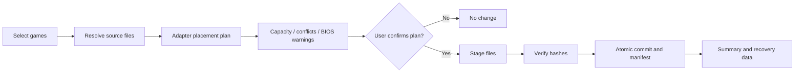

# 08 | Deployment, Capacity Planning and Synchronization

## Use case
Select collections (e.g. Arcade Classics, NES, SNES, Genesis) from any indexed sources and deploy to a supported target installation or folder after a truthful capacity/compatibility preview.

## Pipeline

## Deployment plan contains
- Source file identity and last-observed state; destination installation identity and root.
- Full set of desired destination paths, add/replace/skip/conflict actions, exact bytes.
- Adapter version, paths, required directory creation, supported formats, filesystem maximum file size limitations.
- Capacity calculation from **current** measured free space minus reserve and temporary staging overhead; recheck immediately before copy.
- Conflicts and symlink/case-path collisions; current source/destination snapshots and plan hash.

## Transaction behavior
Stage temporary files in destination where feasible; stream chunks and hashes; atomically rename completed files where supported; journal each item. The full multi-file job cannot always be globally atomic, so clearly mark partial completion and support recovery/cleanup. Never mark a deployment item completed before verification.

## Conflict options
- Keep destination (default when contents differ).
- Skip this item.
- Replace after optional backup and explicit confirmation.
- Rename to side-by-side path if supported by destination adapter.
Never make delete-on-sync the default.

## Synchronization semantics
- New source game: offer deployment to user-selected targets; optional opt-in automation later.
- Removed source game: preserve destination copy unless explicitly requested.
- Metadata changed: plan compatible metadata changes, avoid trampling hand edits.
- Drive disconnected: pause and resume after identity confirmation.
- Library differences: show three-way comparison when previous manifest exists; don't infer which copy should win solely from modified time.
- Job restart: revalidate source/destination identities, partial files and plan before continuing.

## Save-game synchronization is separate
Saves can diverge on multiple devices. Design save metadata/versioning, backup snapshots and explicit per-conflict choices; never automatically overwrite a newer or otherwise different save based only on timestamp. Future scope.

## Example acceptance tests
- 100 files, including names with Unicode and spaces, deploy with every verified hash matching.
- A deliberate destination content conflict is displayed and preserved by default.
- Pulling an external drive mid-copy leaves only temporary files, no false 'complete' entries.
- Source and destination cannot be the same path in a destructive replacement plan.
- A target filesystem with per-file size limit prevents impossible deployments.
- Capacity estimator refuses insufficient space, factoring in staging overhead.
