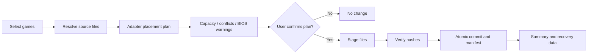

# 08 | Deployment, Capacity Planning and Synchronization

## Use case
Select collections (e.g. Arcade Classics, NES, SNES, Genesis) from any indexed sources and deploy to a supported target installation or folder after a truthful capacity/compatibility preview.

## Pipeline

## Deployment plan contains
- Source file identity and last-observed state; destination installation identity and root.
- Full set of desired destination paths, add/replace/skip/conflict actions, exact bytes.
- Adapter version, paths, required directory creation, supported formats, filesystem maximum file size limitations.
- Capacity calculation from **current** measured free space minus reserve and temporary staging overhead; recheck immediately before copy.
- Conflicts and symlink/case-path collisions; current source/destination snapshots and plan hash.

## Implemented plan rules (RDS-009, `src-tauri/src/deployment.rs`, ADR-020)
The plan is read-only: it reads catalog rows and destination metadata and never creates, copies or changes anything.

| Check | Result |
|---|---|
| Destination relative path is empty, absolute, or has `.`, `..` or `:` parts | **Blocked** (outside the installation) |
| Source path is the destination (the installation's own folder was scanned) | **Already in place** |
| Several library files want one destination (case-insensitive): same size | First one copies (the in-place one wins); the rest are **Duplicate** |
| ...different sizes | All **Blocked** (nobody can pick a winner automatically) |
| File larger than the filesystem allows (FAT32 4 GiB − 1; FAT/FAT16 2 GiB − 1) | **Blocked** |
| A folder on the way is a symlink or junction | **Blocked**: never write through links |
| A file sits where a folder is needed, or a folder/link where the file goes | **Blocked** |
| Destination file exists with the same size | **Already there** (skipped). Content isn't compared in the plan; RDS-010 verifies before skipping |
| Destination file exists with a different size | **Conflict**: the existing file is kept |
| **Same game under another name** (2026-11-07, ADR-042): a single-file game (not arcade/romset systems, not BIOS) whose name matches a file already in the destination folder once tags in `()`/`[]`, punctuation, `_`/`.` and a trailing ", The" are ignored (disc/disk/side/tape/part tags still count) | **Already there under another name**: not copied; the reason names the file on the drive. Choice: *Don't copy* (default) / *Copy anyway* |
| ...or several such versions are in the plan and none is on the drive | The preferred one copies (good dumps over hacks/betas/bad dumps; USA/World, then Europe, then Japan; then the shorter name); the others are **Already there under another name** with *Copy anyway* |
| Otherwise | **Copy** |

A game takes its most serious file action, so a game with one conflicting file isn't partly copied. Full paths over 259 characters are counted as a warning (some emulators can't open them).

**Capacity:** `required = Σ copy files rounded up to whole clusters + one cluster per new folder + the largest copy file (staging/retry room)`. It fits when `required ≤ free − reserve`, where `reserve = max(1 GiB, 2% of the drive)` and `free` is what Windows lets this user write (quotas included). An empty plan always fits; if the drive can't be measured, "fits" is unknown, never yes.

**Selection:** the plan lists every system folder with placeable games; the user picks a subset. Since step 7 (2026-11-05) the plan can instead be limited to one collection ("What to copy"); the platform ticks then apply within it, and the collection id is part of the fingerprint.

**Fingerprint:** a stable 64-bit FNV-1a hash over adapter, contract, installation, and every source, destination, size and action. RDS-010 must rebuild the plan right before copying and refuse to start if the fingerprint changed.

## Implemented copy (RDS-010, `src-tauri/src/copier.rs`, ADR-021, safety review docs/18)
1. **Re-check:** rebuild the plan; the fingerprint must match what the user reviewed; the drive must be the same volume and have room (unknown space refuses). Otherwise nothing is written.
2. **Journal:** a `deployments` row and every `deployment_items` row are written before the first byte.
3. **Per game:** confirm the volume again; compare "already there" files by content (a difference makes the whole game a conflict, kept); then for each file to copy: create missing folders one level at a time (refusing links), record the temp path, create `<name>.rdpart-<id>` with `create_new`, stream with SHA-256, `sync_all`, check the source didn't change, read the temp back past the Windows cache and compare, and rename with no-replace. Only then is it `verified`.
4. **Failures:** the file's own temp is removed; a conflict at rename keeps the existing file; if the drive disappears the deployment is `interrupted`. Verified files of a partly copied game stay; running the copy again checks them and copies the rest.
5. **Cancel:** the file in progress is discarded; verified files stay; the rest are `not_attempted`.
6. **Manifest:** the journal is the catalog record; a JSON copy is written to `<installation>/.retrodrive/deployments/<id>.json` the same safe way.
7. **Startup:** deployments left `running` become `interrupted`; recorded temps are removed only on the confirmed drive, inside that installation, with that deployment's marker.

## Transaction behavior
Stage temporary files in destination where feasible; stream chunks and hashes; atomically rename completed files where supported; journal each item. The full multi-file job cannot always be globally atomic, so clearly mark partial completion and support recovery/cleanup. Never mark a deployment item completed before verification.

## Conflict options
**Implemented 2026-11-05 (step 5b, ADR-028, docs/18 §7):** per item in "Needs your attention": keep the existing file (default), **keep both** (new copy as `Name (2).ext`, single-file games, not arcade-type sets), **replace** (existing file moved to `.retrodrive/backup/<deployment>/…` first, put back on failure, cancel or crash). Clashes between library versions: copy neither (default), **use this version**, or keep both. Choices are part of the plan fingerprint.

- Keep destination (default when contents differ).
- Skip this item.
- Replace after optional backup and explicit confirmation.
- Rename to side-by-side path if supported by destination adapter.
Never make delete-on-sync the default.

## Sync (implemented 2026-11-07, ADR-043)
Owner request: "We should have a Sync button… The Sync should just keep the selected import files synchronized… If the user deletes a file from the drive and RetroDrive scans and sees it is missing then it should ask. Clicking sync should also initiate a check of everything already planned and update it."

Owner correction 2026-11-07: "When we do a plan on a new drive, and we do the first sync we should record what we synced. When we sync again it should only update what we have already synced, not add all games… We should be able to plan and choose what is added. That is one function. Synchronizing is done to provide updates or to correct anything changed erroneously."

- **Plan chooses, Sync maintains (ADR-045, replaces ADR-043's "every platform except those left out").** A plan starts with **nothing ticked**; the user ticks platforms (or picks a collection). When that plan is copied, its platforms (or the collection) are added to the installation's **sync scope** (`installations.sync_scope_json`). Later plan copies add to it.
- **Sync covers only the sync scope:** the synced platforms (including games added to them in the library later) and the games in synced collections. Nothing else is ever added by Sync. With no scope, Sync says "Nothing is synced to this drive yet. Use Plan deployment…".
- **Existing drives:** before a scope is saved, it's derived from what RetroDrive copied there: platforms with at least one copied game still on the drive (a platform whose copied files were all moved off isn't included).
- **Stop syncing something** (in the Sync summary) removes a platform or collection from the scope; games already on the drive stay there.
- **Changed on the drive:** a synced game whose drive file now differs from the library is shown as *changed on the drive*, left as it is by default; *Restore your library's version* is the usual replace (drive file moved to `.retrodrive\backup` first). Never saved, never "for all".
- **One summary, then go:** counts, space, what's kept up to date, then **Start sync**. Art and details are always added afterwards (docs/18 §17).
- **Batocera (2026-11-07, ADR-047):** Sync and art work the same on a Batocera game drive or share; a running Batocera shows new art after Update Gamelists.
- **BIOS files (2026-11-07, owner request, ADR-056, docs/18 §31):** files in a library `bios` folder (any subfolder, any type, except housekeeping files) appear as a **bios** row in Plan and Sync and go to the installation's BIOS folder keeping their subfolders (`bios\dc\dc_boot.bin`): RetroBat and Batocera `bios\`, a RetroPie USB folder `BIOS\`. Same copier rules (no overwrite: different files already there are kept; two library versions → a choice). Not yet: RetroPie's network bios share, ES-DE (each emulator's own folder), `[BIOS] … .zip` sets (archives emulators can't use as they are).
- **BIOS outside the installation folder (2026-11-07, owner "#1", ADR-061, docs/18 §36):** RetroPie over the network (`\\<host>\bios`, its Samba BIOS share) and ES-DE (RetroArch's `system` folder: `Emulators\RetroArch-Win64` or `Emulators\RetroArch` next to a portable `ES-DE.exe`, else `C:\RetroArch-Win64`; `system_directory` from `retroarch.cfg`) get a separate **BIOS files** step in Customize: check, then copy only missing files, new files only (temporary name, checked, no-replace rename), different files already there kept, paths with two different library versions not copied. It doesn't go through Plan or the copier (which keep files inside the installation folder).
- **Everything already copied is checked again** (the copier's "already there" step). A file an earlier copy confirmed by content is not read again when its source and size are the same and neither file was modified or created since that confirmation; anything else is compared by content (ADR-043).
- **Removed from the drive:** a game RetroDrive copied before (verified/identical/replaced in `deployment_items`) whose file is gone is **not copied back silently**. It's listed with *Ask me later* (default; not copied, asked again next time), *Copy it again*, or *Keep it off this drive* (remembered in `sync_kept_off`; shown as *kept off*, can be copied again later).
- **Never deletes:** games removed from the library stay on the drive; nothing on the drive is overwritten (conflicts are kept, as in any copy).
- **Choices don't get in the way (ADR-044):** games needing a choice are skipped and everything else goes ahead; one line under the summary links to *Review choices*. Choices (which version, copy both, copy again) are saved per installation, so the next Sync doesn't ask again. *Replace* is chosen each time and never saved.

## Synchronization semantics
- New source game: offer deployment to user-selected targets; optional opt-in automation later.
- Removed source game: preserve destination copy unless explicitly requested.
- Metadata changed: plan compatible metadata changes, avoid trampling hand edits.
- Drive disconnected: pause and resume after identity confirmation.
- Library differences: show three-way comparison when previous manifest exists; don't infer which copy should win solely from modified time.
- Job restart: revalidate source/destination identities, partial files and plan before continuing.

## Save-game synchronization is separate
Saves can diverge on multiple devices. Design save metadata/versioning, backup snapshots and explicit per-conflict choices; never automatically overwrite a newer or otherwise different save based only on timestamp. Future scope.

## Example acceptance tests
- 100 files, including names with Unicode and spaces, deploy with every verified hash matching.
- A deliberate destination content conflict is displayed and preserved by default.
- Pulling an external drive mid-copy leaves only temporary files, no false 'complete' entries.
- Source and destination cannot be the same path in a destructive replacement plan.
- A target filesystem with per-file size limit prevents impossible deployments.
- Capacity estimator refuses insufficient space, factoring in staging overhead.
